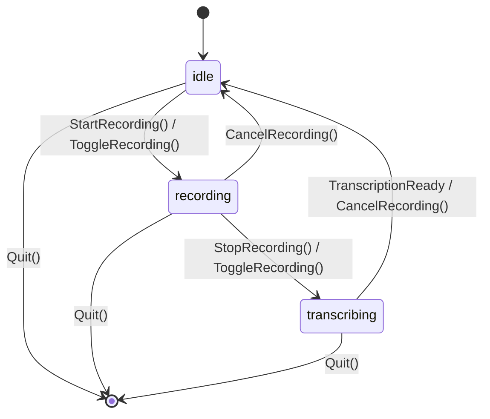

# WhisperAloud D-Bus API

WhisperAloud exposes its recording/transcription engine, history store, and
configuration over the D-Bus session bus. The daemon (`service/daemon.py`)
is the only process that talks to the microphone and the Whisper model; the
GTK4 GUI, the CLI, the tray indicator, and global hotkeys are thin clients
of this interface (`service/client.py`).

This document is the stable, versioned reference for that interface. It is
generated by hand from the interface's canonical source of truth — the
`WhisperAloudService` class docstring in `src/whisper_aloud/service/daemon.py`,
which pydbus reads directly as introspection XML — and from the committed
snapshot at `tests/contracts/org.fede.whisperaloud.Control.xml`. If this
document and the snapshot ever disagree, the snapshot (and the daemon
source it is generated from) wins; please file a bug.

## Bus name, object path, interface

| | |
|---|---|
| Bus | Session bus (`DBUS_SESSION_BUS_ADDRESS`), **not** the system bus |
| Bus name | `org.fede.whisperaloud` |
| Object path | `/org/fede/whisperaloud` |
| Interface | `org.fede.whisperaloud.Control` |

The interface is implemented by a single pydbus-published object; there is
exactly one instance of the service per session.

## Daemon states

The daemon is a simple state machine, reported by `GetStatus()["state"]` and
broadcast via the `StatusChanged` signal:



Text form, for anyone who can't render Mermaid:

```
            StartRecording() / ToggleRecording()
   ┌───── idle ───────────────────────────────► recording ─────┐
   │        ▲                                                  │
   │        │          StopRecording() / ToggleRecording()     │
   │        │                                                  ▼
   │        │                                           transcribing
   │        └──────────── CancelRecording() ◄────────────────┘
   │                 (from either recording or transcribing)
   │
   └── Quit() from any state tears the process down.
```

`error` is not a steady state; it is a fallback value `GetStatus()` can
report if the recorder failed to initialize (see `GetStatus`, below). It is
not entered or left via a tracked transition and has no corresponding
`StatusChanged("error")` emission today.

## Methods

All methods are synchronous D-Bus calls with no timeout override — the
caller's D-Bus bindings' default method-call timeout applies (25s for
pydbus/GDBus). `StartRecording` / `StopRecording` / `ToggleRecording` /
`CancelRecording` never raise a D-Bus error reply for expected failure
modes; they report failure via return value plus an `Error` signal (see
"Error behaviour" below) so that a GUI observing only signals stays in
sync. Unexpected failures (e.g. a bad argument type) still surface as a
standard D-Bus error reply from the underlying library.

### StartRecording

```
StartRecording() → (b success)
```

Starts audio recording. Valid when **idle**. If recording-flow options are
enabled in config (`pause_media`, `raise_mic_gain`), those side effects run
synchronously before capture starts.

- Returns `true` and emits `RecordingStarted` then `StatusChanged("recording")`
  on success.
- Returns `false` and emits `Error("recorder_error", ...)` if the recorder
  failed to initialize at daemon startup.
- Returns `false` and emits `Error("recording_failed", <message>)` if
  starting the audio stream raises (e.g. no capture device). Any mic-gain
  change already applied is rolled back.
- Returns `false` and emits **no** signal while **transcribing** (WHISP-57):
  the previous recording's transcription (batch or a streaming engine's
  `finalize()`) is still running in the background, and starting a new
  session now would touch the same engine instance's shared state while
  that job is still using it. Call `GetStatus()` or wait for
  `TranscriptionReady`/`Error` before retrying.
- Calling it while already **recording** restarts capture via the
  underlying recorder rather than raising; prefer checking `GetStatus()`
  first.

### StopRecording

```
StopRecording() → (s text)
```

Stops the active recording and starts transcription **asynchronously** in a
background thread. Valid when **recording**. The return value is a status
string, not the transcript — the transcript arrives later via
`TranscriptionReady`.

- Returns `"transcribing"` on success, after emitting `RecordingStopped`
  then `StatusChanged("transcribing")`.
- Returns `"error"` and emits `Error("component_error", ...)` if the
  recorder or transcriber is not initialized.
- Returns `"error"` and emits `Error("stop_failed", <message>)` if stopping
  the audio stream raises.
- Mic-gain restore and media-resume are best-effort: failures there are
  logged, not surfaced as an `Error` signal, and do not change the return
  value.

### ToggleRecording

```
ToggleRecording() → (s state)
```

Convenience wrapper: calls `StopRecording()` if currently recording,
otherwise `StartRecording()`. Valid in any state; semantics otherwise match
whichever of the two methods it dispatches to.

- Returns `"recording"` when `StartRecording()` actually started a session.
- Returns `"transcribing"` when `StartRecording()` refused because a
  previous transcription is still in flight (see `StartRecording`'s own
  caveat); no new recording starts and no `RecordingStarted` signal is
  emitted in this case.
- Returns `"error"` when `StartRecording()` refused for any other reason
  (e.g. the recorder isn't initialized, or starting raised); an `Error`
  signal was also emitted.
- Returns `StopRecording()`'s return value (`"transcribing"` or `"error"`)
  when it stopped a recording.

> As of API 1.2.0, `ToggleRecording()`'s return value always reflects the
> real resulting state (see `GetStatus()["state"]`). Before 1.2.0, it
> unconditionally returned the literal string `"recording"` after calling
> `StartRecording()`, even when `StartRecording()` had refused.

### CancelRecording

```
CancelRecording() → (b success)
```

Cancels in-progress recording or transcription without producing a
transcript. Valid when **recording** or **transcribing**; returns `false`
and emits no signal when called while **idle**.

- From **recording**: stops capture, discards audio, restores mic
  gain/media, emits `StatusChanged("idle")`, returns `true`.
- From **transcribing**: requests transcription cancellation on the active
  engine (best-effort -- the engine may finish anyway, or return a partial
  result, before noticing the request), emits `StatusChanged("idle")`,
  returns `true`.
- From **idle**: returns `false`, no side effects.

A cancel means no transcript surfaces, full stop: if the in-flight
transcription job (batch `transcribe_numpy()` or a streaming engine's
`finalize()`) finishes anyway after `CancelRecording()` already returned,
its result is dropped internally. No `TranscriptionReady` (or `Error`) is
emitted for it, it is not copied to the clipboard, it is not pasted, and no
history row is written for it. This holds regardless of whether the
engine's own cancellation was honoured.

### GetStatus

```
GetStatus() → (a{sv} status)
```

Valid in any state. Returns a dict of GLib variants:

| Key | Type | Meaning |
|---|---|---|
| `state` | `s` | One of `idle`, `recording`, `transcribing`, or `error` (see "Daemon states") |
| `version` | `s` | WhisperAloud package version (`whisper_aloud.__version__`) |
| `model` | `s` | Configured model name (`config.model.name`) |
| `device` | `s` | Configured inference device (`config.model.device`), e.g. `cpu`, `cuda` |
| `hotkey_backend` | `s` | Active global-hotkey backend: `xdg-portal`, `libkeybinder3`, or `none` |
| `uptime` | `d` | Seconds since the daemon process started |
| `downloading` | `b` | True while a `DownloadModel()` job is in flight (WHISP-68) |

### GetHistory

```
GetHistory(u limit) → (aa{sv} entries)
```

Valid in any state. Returns up to `limit` most recent history entries
(`limit` is clamped to at least 1). Each entry is a dict of variants — see
"History entry shape" below.

### SearchHistory

```
SearchHistory(s query, u limit) → (aa{sv} entries)
```

Valid in any state. Full-text search (SQLite FTS5) over history text,
returning up to `limit` matches. An empty/whitespace-only `query` falls
back to `GetHistory(limit)`. On a search engine failure, returns an empty
list and emits `Error("history_search_failed", <message>)`.

### GetFavoriteHistory

```
GetFavoriteHistory(u limit) → (aa{sv} entries)
```

Valid in any state. Returns up to `limit` entries marked as favorites. On
failure, returns an empty list and emits `Error("history_fetch_failed", <message>)`.

### ToggleHistoryFavorite

```
ToggleHistoryFavorite(i entry_id) → (b success)
```

Valid in any state. Flips the favorite flag on a history entry. Returns
`false` and emits `Error("history_update_failed", <message>)` on failure
(e.g. unknown `entry_id`).

### DeleteHistoryEntry

```
DeleteHistoryEntry(i entry_id) → (b success)
```

Valid in any state. Permanently deletes a history entry (and its archived
audio, if any). Returns `false` and emits
`Error("history_delete_failed", <message>)` on failure.

### UpdateHistoryEntry

```
UpdateHistoryEntry(i entry_id, s text) → (b success)
```

Valid in any state. Overwrites the transcribed text of a history entry
(e.g. a manual correction). Returns `false` and emits
`Error("history_update_failed", <message>)` on failure.

### ExportHistory

```
ExportHistory(s format, a{sv} filters) → (s content)
```

Valid in any state. Renders history entries matching `filters` to one of
four formats and returns the result as a string — it does **not** write
anything to disk. `format` is one of:

| `format` | Content |
|---|---|
| `"md"` | Markdown, grouped by date, one section per entry |
| `"json"` | A JSON array of entry objects (`ensure_ascii=False` — accented characters are written literally, not as `\uXXXX` escapes) |
| `"csv"` | One header row plus one row per entry; text/tags/notes fields containing commas, quotes, or newlines are quoted per RFC 4180 |
| `"txt"` | Plain text, transcriptions only, no metadata |

`filters` (all optional):

| Key | Type | Meaning |
|---|---|---|
| `since` | `s` | ISO 8601 date or datetime (e.g. `"2026-01-01"` or `"2026-01-01T13:30:00"`); inclusive lower bound on timestamp |
| `until` | `s` | Same format; inclusive upper bound. A date-only value (no time component) is treated as the **end** of that day, not midnight at its start — so `until="2026-01-31"` includes everything from the 31st |
| `favorites_only` | `b` | Only entries with the favorite flag set |
| `query` | `s` | FTS5 search text (same engine as `SearchHistory`); empty/whitespace-only is treated as no filter |
| `limit` | numeric | Maximum entries to include. Missing or `<= 0` defaults to **500**; any value above **5000** is silently capped there (`EXPORT_DEFAULT_LIMIT`/`EXPORT_MAX_LIMIT` in `daemon.py`) — this bounds how large a single D-Bus reply string can get |

All filters compose: e.g. `{"favorites_only": true, "query": "budget",
"since": "2026-01-01"}` returns only favorited entries from 2026-01-01
onward whose text/tags/notes match "budget".

Returns `""` and emits an `Error` signal on failure, without touching
`history_manager`:

- `Error("export_invalid_format", <message>)` — `format` isn't one of the
  four above.
- `Error("export_invalid_filter", <message>)` — `since`/`until` isn't a
  parseable ISO date/datetime, or `limit` isn't a number.
- `Error("export_failed", <message>)` — the query or render itself raised
  (e.g. a database error).

**Why this method returns a string instead of accepting an output path**:
a D-Bus method that writes to a caller-supplied filesystem path is a
privileged-path-write vector — the daemon would be writing a file wherever
*any* session-bus client asked, not just this project's own CLI/GUI, with
no sandboxing of the destination. Returning the content and letting the
client write it keeps that write inside the client's own, already-scoped
filesystem permissions. The tradeoff is the `limit` cap above, since the
whole export must fit in one D-Bus method reply.

### History entry shape

`GetHistory` / `SearchHistory` / `GetFavoriteHistory` all return entries
serialized the same way by `_serialize_history_entry`; field names and
types mirror the `persistence` layer's history record (id, text, timestamp,
favorite flag, duration, model used, etc.) as GLib variants. See
`src/whisper_aloud/persistence/` for the authoritative field list — it is
intentionally not duplicated field-by-field here to avoid a second place
that can drift; the contract test only pins the *method* surface, not this
nested shape.

### GetConfig

```
GetConfig() → (a{sv} config)
```

Valid in any state. Returns the full configuration, flattened to
`"<section>.<field>"` keys (e.g. `"model.name"`, `"hotkey.toggle_recording"`),
each value as a GLib variant (`b`, `i`, `d`, or `s`; everything else is
stringified).

### SetConfig

```
SetConfig(a{sv} changes) → (b success)
```

Valid in any state. Applies a partial set of `"<section>.<field>"` changes
(same flattened keys as `GetConfig`), validates the resulting config, and
persists it to disk **immediately**, regardless of daemon state. `ConfigChanged`
is also emitted immediately. The config returned by a subsequent `GetConfig()`
always reflects the new values right away, even mid-recording or
mid-transcription.

- Returns `true` and emits `ConfigChanged(changes)` on success.
- Returns `false` and emits `Error("config_invalid", <message>)` if the
  resulting config fails validation (e.g. unknown field, bad value) or an
  unexpected key/value shape is passed.

Re-initializing the *components themselves* is not always immediate, though:

- An audio-pipeline change recreates the `AudioRecorder` right away.
- A hotkey change re-registers the hotkey right away.
- A **model-reload change** (engine/name/device/compute_type, or a
  transcription field such as `language` that also forces a reload) is
  deferred when the daemon is **recording** or **transcribing**: the new
  engine is *not* built yet, and the in-flight job keeps running against the
  engine instance it started with, uninterrupted and uncorrupted. The
  deferred reload is applied automatically the next time the daemon returns
  to **idle** -- whether that is via a completed transcription
  (`TranscriptionReady`), a failed one (`Error`), or `CancelRecording()`. If
  more than one model-reload `SetConfig()`/`ReloadConfig()` call lands while
  busy, only the last one's config is kept and applied; the earlier one(s)
  are superseded, not queued. When the daemon is already idle, the reload
  happens synchronously inside this call, same as before.

### ReloadConfig

```
ReloadConfig() → (b success)
```

Valid in any state. Re-reads `~/.config/whisper_aloud/config.json` from
disk (picking up external edits) and applies it the same way `SetConfig`
does, including the same deferred-reload behavior when the daemon is busy
(see `SetConfig` above).

- Returns `true` and emits `ConfigChanged({})` (empty changes dict — this
  is a full reload, not a diff) on success.
- Returns `false` and emits `Error("reload_failed", <message>)` on failure
  (e.g. malformed config file). The live (in-memory) config is left exactly
  as it was before the call -- a failed reload never partially applies.

Note the asymmetry with daemon *startup*: `WhisperAloudConfig.load()` is
used both at startup and here, but only `ReloadConfig()` passes
`strict=True`. At startup, a malformed `config.json` logs an error and
falls back to in-memory defaults without ever rewriting the file (nothing
in the startup path calls `save()`) — the daemon still comes up, using
defaults, rather than refusing to start over a config problem the user may
not even be aware of yet. An explicit `ReloadConfig()` call is different:
the caller is deliberately asking to pick up the file as it is *right
now*, so silently substituting defaults for a broken file would look like
a successful reload while actually discarding whatever the user meant to
load — hence the strict failure instead (WHISP-71).

### Quit

```
Quit() → (b success)
```

Valid in any state. Requests an orderly shutdown of the daemon process
(stops the GLib main loop, runs cleanup, process exits). Always returns
`true` — once a GLib main loop exists, `Quit()` just calls `loop.quit()`;
a nonexistent loop (not reachable via `run()`) is the only path through
`False` and only matters for unit tests that construct the service without
calling `run()`.

### DownloadModel

```
DownloadModel(s engine, s name, b accept_license) → (b started)
```

Valid in any state. Starts a background download of a `stt.catalog` `(engine,
name)` model, so a model can be fetched ahead of time with progress feedback
instead of blocking the daemon's next `ReloadConfig()`/`SetConfig()`-triggered
model reload the way an undiscovered-ahead-of-time model switch does today
(see `ReloadConfig`/`SetConfig` above).

`started` is `true` only if a download was actually kicked off — it does not
mean the download *succeeded*; watch `DownloadProgress`/`DownloadFinished` for
that. Returns `false` (and starts nothing) when:

- a download is already running — only one `DownloadModel()` job at a time;
  call `CancelDownload()` first if you want to switch targets;
- `(engine, name)` isn't a known catalog entry — emits
  `Error("download_invalid_model", <message>)`;
- the entry has `needs_review=True` (a license pending human review -- no
  catalog entry is in this state as of WHISP-86: `nemotron-streaming`'s
  OpenMDW-1.1 license was reviewed and accepted by the maintainer on
  2026-10-03, not via a formal legal review; see
  `docs/THIRD_PARTY_MODELS.md`) and `accept_license` is not `true` — emits
  `Error("download_license_review_required", <message>)`. This mirrors the
  Settings UI's existing convention of hiding such entries from the default
  model picker, enforced here too so a scripted/CLI caller can't silently
  fetch a model nobody has reviewed. Passing `accept_license=true` is the
  caller's explicit acknowledgement of that model's license. A model whose
  license has already been reviewed but is merely non-standard for this
  project (e.g. `nemotron-streaming`'s OpenMDW-1.1, or `parakeet`'s
  CC-BY-4.0) is unaffected by this gate -- it downloads normally; only the
  Settings UI's own consent dialog / the CLI's license notice apply.

`DownloadModel` routes any catalog entry with a `download_url` (the sherpa-onnx
tarball backend -- today `parakeet` and `nemotron-streaming`) through
`model_download.download_model`, and `faster-whisper` through its own
Hugging Face backend. An entry with neither raises internally and is reported
via `DownloadFinished(..., ok=false, error=...)` (WHISP-86: this used to be
hardcoded to `engine == "parakeet"`, which left `nemotron-streaming` unable to
ever download via this method despite having a `download_url`).

### CancelDownload

```
CancelDownload() → (b success)
```

Valid in any state. Requests cancellation of the in-flight `DownloadModel()`
job, if any. Returns `true` only if a cancellation was requested (i.e.
something was downloading) — it does not block until the download actually
stops. The eventual `DownloadFinished(..., ok=false, error="cancelled")`
signal is the authoritative completion notice.

Cancellation granularity differs by engine (see `DownloadProgress` below for
why): a Parakeet (sherpa-onnx) download is a single file and stops
essentially immediately; a faster-whisper (Hugging Face Hub) download can
only stop between chunks of whichever file(s) are in flight at the moment of
the request, since `huggingface_hub.snapshot_download()` has no public
per-file-boundary cancellation hook.

## Properties

### ApiVersion

```
readonly s ApiVersion
```

Valid in any state. The semantic version of the `org.fede.whisperaloud.Control`
interface itself (see "Versioning policy" below), e.g. `"1.0.0"` — **not**
the WhisperAloud application version (that's `GetStatus()["version"]`).
Read it with the standard `org.freedesktop.DBus.Properties.Get` interface,
e.g. (see examples below).

## Signals

### RecordingStarted

```
RecordingStarted()
```

Emitted once capture has actually started, as part of a successful
`StartRecording()`.

### RecordingStopped

```
RecordingStopped()
```

Emitted once capture has stopped, as part of a successful `StopRecording()`
— before transcription begins.

### TranscriptionReady

```
TranscriptionReady(s text, a{sv} meta)
```

Emitted from a background thread (via `GLib.idle_add`-safe signal emission)
when transcription of the most recent recording finishes. `text` is the
final transcript (already pasted/copied per config, if enabled). `meta` is
an implementation-defined metadata dict (e.g. duration, model used,
history entry id) — not pinned by the contract test; treat unknown keys as
optional/forward-compatible.

### LevelUpdate

```
LevelUpdate(d level)
```

Emitted at up to 10Hz while recording, with the current peak input level
(0.0–1.0-ish, depending on the audio pipeline's gain staging). Purely
cosmetic (VU meter); not emitted outside **recording**.

### PartialTranscript

```
PartialTranscript(s session_id, s committed, s tentative, u seq)
```

Emitted only while **recording** with a streaming engine configured (one
whose `StreamingSpeechEngine.is_streaming` is `True` — today, the
`nemotron-streaming` engine or the test-only streaming fake engine; a
non-streaming engine, e.g. `faster-whisper` or `parakeet`, never emits
this). Polled from the engine at `PARTIAL_TRANSCRIPT_HZ` (5Hz by default)
and re-emitted only when `seq` has advanced since the last emission, so a
client never sees a duplicate.

- `session_id` identifies the recording session (a fresh `uuid4().hex`
  generated in `StartRecording`, the same value as `TranscriptionReady`'s
  `meta["session_id"]` for this recording) — use it to discard stale
  partials after a cancel/restart race.
- `committed` is the stable prefix of the transcript so far; it is never
  retracted (monotonically non-decreasing length) once reported.
- `tentative` is the unstable in-flight tail that may still be revised by a
  later update.
- `seq` is a monotonically increasing sequence number, one per engine
  update, scoped to this session — use it for ordering/dedup.

On `StopRecording`, the engine's `finalize()` result (not the last
`committed`+`tentative` partial) is the authoritative final text delivered
via `TranscriptionReady`; clients should replace their partial view with it
at that point rather than concatenating.

### StatusChanged

```
StatusChanged(s state)
```

Emitted on every state transition driven by the methods above
(`"recording"`, `"transcribing"`, `"idle"`). This is the signal a client
should use to track daemon state — `GetStatus()` is a point-in-time poll,
this is the push counterpart.

### ConfigChanged

```
ConfigChanged(a{sv} changes)
```

Emitted after `SetConfig` (with the actual changes applied) or
`ReloadConfig` (with an empty dict, since it's a full reload rather than a
diff).

### Error

```
Error(s code, s message)
```

Emitted alongside a `false`/`"error"` return value for most methods that
can fail (see each method's "Error behaviour" above for the specific
`code` values in use: `recorder_error`, `recording_failed`,
`component_error`, `stop_failed`, `history_search_failed`,
`history_fetch_failed`, `history_update_failed`, `history_delete_failed`,
`config_invalid`, `reload_failed`, `download_invalid_model`,
`download_license_review_required`). `code` values are stable identifiers
intended for programmatic matching; `message` is a free-form, untranslated
diagnostic string not intended for parsing.

### DownloadProgress

```
DownloadProgress(s engine, s name, t bytes_done, t bytes_total)
```

Emitted from the download's background thread (via `GLib.idle_add`-safe
signal emission, like `TranscriptionReady`) while a `DownloadModel()` job is
in flight, throttled to roughly 4Hz (the first update and the
completed/boundary update are always let through unthrottled, so clients see
an immediate "started" and a crisp "100%" even under throttling).

`bytes_total == 0` means the total size is not known yet:

- **sherpa-onnx (Parakeet)**: the server didn't report a `Content-Length`.
- **faster-whisper**: the installed `huggingface_hub` predates per-file
  progress-hook support (`tqdm_class` on `snapshot_download`); progress is
  reported as a single indeterminate `(0, 0)` start and end event in that
  case. When `tqdm_class` *is* supported, `bytes_total` is the sum of only
  the per-file totals known so far — it can briefly under-report right at
  the start of a multi-file download before converging to the true total;
  treat an increasing `bytes_total` as normal, not a shrinking download.

Clients should render an indeterminate/pulsing progress indicator whenever
`bytes_total == 0`.

### DownloadFinished

```
DownloadFinished(s engine, s name, b ok, s error)
```

Emitted exactly once per `DownloadModel()` job, when it finishes — whether
successfully, with an error, or because `CancelDownload()` was called
(`ok == false` and `error == "cancelled"` in that case). Clients should treat
this as the point to re-check the model's downloaded state (e.g. re-query
`stt.catalog`/refresh a model picker row) rather than polling.

## Activation

WhisperAloud uses standard D-Bus service activation plus a systemd user
unit, so a client calling any method on `org.fede.whisperaloud` starts the
daemon on demand if it isn't already running:

- `data/org.fede.whisperaloud.service` is the D-Bus activation file
  (installed to `/usr/share/dbus-1/services/`):

  ```ini
  [D-BUS Service]
  Name=org.fede.whisperaloud
  SystemdService=whisper-aloud.service
  ```

  `SystemdService=` tells `dbus-daemon` to activate the name via systemd
  (`systemctl --user start whisper-aloud.service`) rather than by forking
  `Exec=` directly, so the daemon runs under the user's systemd scope
  (cgroup accounting, `journalctl --user -u whisper-aloud`, restart policy).

- `data/whisper-aloud.service` is that systemd user unit. Relevant bits:

  ```ini
  [Service]
  Type=dbus
  BusName=org.fede.whisperaloud
  ExecStart=/usr/lib/whisper-aloud/run --daemon
  SuccessExitStatus=3
  RestartPreventExitStatus=3
  ```

  `Type=dbus` + `BusName=` means systemd itself watches for the name to
  appear on the bus to consider the unit "started" (rather than just the
  process forking).

- **Exit code 3 (`EXIT_ALREADY_RUNNING`)**: three different things can try
  to start the daemon (systemd activation, an XDG autostart fallback, and
  a manual `whisper-aloud --daemon`). Only one can ever own the bus name.
  The daemon (via `handle_daemon_command` in `__main__.py`) calls
  `acquire_bus_name(bus)` **before** constructing `WhisperAloudService` —
  i.e. before touching audio/tray/model — so a losing attempt fails fast.
  If another process already owns `org.fede.whisperaloud`, the daemon
  prints an error and exits with status `3`
  (`whisper_aloud.service.daemon.EXIT_ALREADY_RUNNING`). The systemd unit
  maps exit code 3 to `SuccessExitStatus`/`RestartPreventExitStatus` so the
  losing instance is treated as a clean, non-retried stop rather than a
  crash-restart loop.

## Versioning policy

The `org.fede.whisperaloud.Control` interface follows semantic versioning,
exposed at runtime via the read-only `ApiVersion` property and tracked in
the "Changelog" section below.

- **Additive, backward-compatible changes are a minor bump** (`1.0.0` →
  `1.1.0`): a new method, a new signal, a new optional/informational key in
  an existing `a{sv}` dict (`GetStatus`, `GetConfig`, history entries,
  `TranscriptionReady`'s `meta`), a new property. Existing clients
  continue to work unmodified.
- **A patch bump** (`1.0.0` → `1.0.1`) is for interface-document fixes or
  corrected documentation of existing behaviour with no change to the
  wire format at all.
- **Breaking changes require a major bump and a new interface name**:
  removing or renaming a method/signal/property, changing an argument's
  D-Bus type signature, changing argument order, or changing the meaning
  of an existing return value in an incompatible way. The daemon publishes
  the new interface **alongside** the old one under a versioned name —
  `org.fede.whisperaloud.Control2` for the first breaking revision,
  `Control3` for the next, and so on — rather than mutating
  `org.fede.whisperaloud.Control` in place.
- **Deprecation window**: when a breaking change ships, the previous
  interface version (`Control`, then `Control2`, ...) stays published,
  functionally unchanged, for at least one stable release cycle after the
  new one ships, and its deprecation is announced in this document's
  changelog and in the release notes before removal. Methods/signals that
  will not survive the next major bump should also be called out in-line
  in this document ahead of time, not just at removal time.
- `ApiVersion` always reports the version of whichever named interface the
  client queries — a `Control2` object's `ApiVersion` reports a `2.x.y`
  value, etc. There is one `ApiVersion` property per published interface,
  not one per daemon.

This policy covers the interface contract only (method/signal/property
shapes). It says nothing about the stability of `GetConfig`'s flattened
key names, which track `WhisperAloudConfig`'s own field names and can
change independently (config is explicitly not meant to be a stable
cross-version API surface the way the method signatures are).

## Planned

Not yet available — tracked here so API consumers can plan for it ahead of
implementation:

- **GUI live partial-text display** (WHISP-58): the GUI does not yet render
  `PartialTranscript` anywhere; it is only emitted by the daemon and
  wrapped by `client.py` so far.

## Examples

All examples assume the daemon is already running (or activatable) on your
session bus, i.e. `echo $DBUS_SESSION_BUS_ADDRESS` is non-empty.

### busctl

```sh
# Introspect the interface
busctl --user introspect org.fede.whisperaloud /org/fede/whisperaloud

# Call a no-argument method
busctl --user call org.fede.whisperaloud /org/fede/whisperaloud \
  org.fede.whisperaloud.Control StartRecording

# Call a method with arguments (GetHistory: one 'u' in-arg)
busctl --user call org.fede.whisperaloud /org/fede/whisperaloud \
  org.fede.whisperaloud.Control GetHistory u 10

# Read a property
busctl --user get-property org.fede.whisperaloud /org/fede/whisperaloud \
  org.fede.whisperaloud.Control ApiVersion

# Watch signals
busctl --user monitor org.fede.whisperaloud
```

### gdbus

```sh
# Call a method
gdbus call --session --dest org.fede.whisperaloud \
  --object-path /org/fede/whisperaloud \
  --method org.fede.whisperaloud.Control.ToggleRecording

# Read a property via the standard Properties interface
gdbus call --session --dest org.fede.whisperaloud \
  --object-path /org/fede/whisperaloud \
  --method org.freedesktop.DBus.Properties.Get \
  org.fede.whisperaloud.Control ApiVersion

# Monitor signals
gdbus monitor --session --dest org.fede.whisperaloud
```

### Python (pydbus)

```python
from pydbus import SessionBus

bus = SessionBus()
daemon = bus.get("org.fede.whisperaloud")

print(daemon.ApiVersion)          # property access, e.g. "1.0.0"
print(daemon.GetStatus())         # {'state': 'idle', 'version': '...', ...}

daemon.StartRecording()
daemon.StopRecording()            # returns "transcribing"; wait for the signal

daemon.TranscriptionReady.connect(lambda text, meta: print("got:", text))

from gi.repository import GLib
GLib.MainLoop().run()
```

This is exactly the pattern `src/whisper_aloud/service/client.py`
(`WhisperAloudClient`) wraps for the GUI/CLI/tray.

### Python (Gio)

Lower-level, no pydbus dependency — useful for a minimal standalone script:

```python
import gi
gi.require_version("Gio", "2.0")
from gi.repository import Gio, GLib

BUS_NAME = "org.fede.whisperaloud"
OBJECT_PATH = "/org/fede/whisperaloud"
IFACE = "org.fede.whisperaloud.Control"

bus = Gio.bus_get_sync(Gio.BusType.SESSION, None)

proxy = Gio.DBusProxy.new_sync(
    bus, Gio.DBusProxyFlags.NONE, None,
    BUS_NAME, OBJECT_PATH, IFACE, None,
)

# Method call
result = proxy.call_sync(
    "GetStatus", None, Gio.DBusCallFlags.NONE, -1, None,
)
print(result.unpack())

# Property read (via org.freedesktop.DBus.Properties)
props_proxy = Gio.DBusProxy.new_sync(
    bus, Gio.DBusProxyFlags.NONE, None,
    BUS_NAME, OBJECT_PATH, "org.freedesktop.DBus.Properties", None,
)
api_version = props_proxy.call_sync(
    "Get", GLib.Variant("(ss)", (IFACE, "ApiVersion")),
    Gio.DBusCallFlags.NONE, -1, None,
).unpack()[0]
print(api_version)

# Signal subscription
def on_signal(connection, sender, path, iface, signal, params):
    print(signal, params.unpack())

bus.signal_subscribe(
    BUS_NAME, IFACE, None, OBJECT_PATH, None,
    Gio.DBusSignalFlags.NONE, on_signal,
)

GLib.MainLoop().run()
```

## Changelog

This changelog tracks the `org.fede.whisperaloud.Control` interface
contract itself (methods, signals, properties, and their shapes) — not the
WhisperAloud application version, and not `GetConfig`'s internal key
names.

### 1.4.0 — 2026-10-02

Minor (additive), WHISP-79: history export and search exposed over D-Bus
(and the CLI's `history list`/`history search`/`history export`), closing
out WHISP-40's FTS5-history-with-search-and-export differentiator.

- **New method** `ExportHistory(s format, a{sv} filters) → (s content)`:
  renders history entries to `"md"`/`"json"`/`"csv"`/`"txt"` and returns the
  content as a string — the daemon never writes to a filesystem path on the
  caller's behalf (see the method's own section above for why). `filters`
  supports `since`/`until` (ISO date/datetime), `favorites_only`, `query`
  (FTS5), and a capped `limit` (default 500, max 5000), all composable.
- **`Error`'s `code` values gain three new entries**: `export_invalid_format`,
  `export_invalid_filter`, `export_failed`.
- `SearchHistory` and `GetHistory` are unchanged — `ExportHistory` is a new,
  separate method rather than an export flag on an existing one, since its
  filter shape (date range + favorites + query combined) is strictly wider
  than what those two already support.

### 1.3.0 — 2026-10-02

Minor (additive), WHISP-68: in-app model download with progress and cancel.

**Versioning/ordering note**: this bump was coordinated with `fix/WHISP-72`,
which independently took `1.2.0` for an unrelated additive change (see that
entry below) — `1.3.0` here is additive on top of `1.2.0`, confirmed by
rebasing this branch onto `1.2.0` after it merged to `master`, so the two
entries form a consistent, monotonically additive sequence rather than two
sibling branches disagreeing about what `1.2.0` contains.

- **New method** `DownloadModel(s engine, s name, b accept_license) → (b
  started)`: starts a background download of a `stt.catalog` `(engine, name)`
  model. Refuses (returns `false`, no-op) when a download is already
  running, the model is unknown, or the entry is `needs_review` and
  `accept_license` isn't `true`. (As of WHISP-86, no shipped catalog entry is
  `needs_review` -- `nemotron-streaming`'s OpenMDW-1.1 license was reviewed
  and accepted by the maintainer on 2026-10-03, not via a formal legal
  review.)
- **New method** `CancelDownload() → (b success)`: requests cancellation of
  the in-flight download, if any.
- **New signal** `DownloadProgress(s engine, s name, t bytes_done, t
  bytes_total)`: throttled to ~4Hz; `bytes_total == 0` means indeterminate
  (unknown total size).
- **New signal** `DownloadFinished(s engine, s name, b ok, s error)`:
  terminal event for a `DownloadModel()` job (success, failure, or
  cancellation — `error == "cancelled"` in the latter case).
- **`GetStatus`'s `a{sv}` return value gains a new key**: `"downloading"`
  (`b`) — true while a download is in flight.
- **`Error`'s `code` values gain two new entries**: `download_invalid_model`,
  `download_license_review_required`.
- **Known limitation, documented rather than fixed here**: `CancelDownload()`
  for a faster-whisper (Hugging Face Hub) download can only take effect
  between chunks of whichever file(s) are downloading at the moment of the
  request — `huggingface_hub.snapshot_download()` has no public per-file-
  boundary cancellation hook. A Parakeet (sherpa-onnx) download is always a
  single file and cancels essentially immediately.

### 1.2.0 — 2026-10-02

Minor (observable return-value change), WHISP-72:

- **ToggleRecording**: now returns the real resulting state instead of
  unconditionally returning the literal string `"recording"` after calling
  `StartRecording()`. When `StartRecording()` refuses because a previous
  transcription is still in flight, `ToggleRecording()` now returns
  `"transcribing"`; for any other refusal it returns `"error"`. The
  pre-1.2.0 value in this refusal branch was already documented as an
  unreliable literal (the caveat this entry removes) that callers were
  told not to trust and to instead watch `StatusChanged`/`Error` -- no
  client could have correctly relied on `"recording"` meaning a recording
  actually started there. Treated as a minor bump rather than a patch
  because the string a caller receives for that call does change; treated
  as a minor bump rather than a major/`Control2` bump because the
  documented, reliable part of the contract (`"recording"` on an actual
  start, `StopRecording()`'s return value when stopping) is unchanged and
  no method/signal/argument shape or type changed.

### 1.1.1 — 2026-10-01

Patch (documentation/behavior clarification, no wire-format change),
WHISP-70/WHISP-73/WHISP-74:

- **SetConfig/ConfigChanged** (WHISP-70): fixed a real bug where a non-empty
  `SetConfig(a{sv} changes)` call always failed end-to-end. `client.py`'s
  `set_config()` forwarded a plain Python dict straight to the pydbus proxy
  instead of wrapping each value as a `GLib.Variant`, so pydbus rejected the
  call client-side before it ever reached the daemon
  ("Expected GLib.Variant, but got <type>"); fixing that then exposed a
  second, previously-dormant instance of the same bug on the daemon side --
  `SetConfig()`/`ReloadConfig()` re-emitted `ConfigChanged`'s `a{sv}` payload
  with bare, unwrapped values, which raised the identical error inside the
  daemon's own call. Both are now wrapped via a shared
  `_wrap_flat_config_as_variants()` helper (also used by `GetConfig()`). The
  `a{sv}` *wire signature* itself never changed -- GLib.Variant-wrapped
  values are what `a{sv}` always meant; the bug was that neither side's
  Python code actually produced them for a non-empty payload.
- **CancelRecording** (WHISP-73): clarified that "without producing a
  transcript" is an absolute guarantee, not best-effort -- a transcription
  job already in flight when `CancelRecording()` is called can no longer
  leak a late `TranscriptionReady`/`Error`, clipboard copy/paste, or history
  row after the daemon has already reported `StatusChanged("idle")`. Fixed
  a real bug: previously, a cooperative-but-slow (or non-cooperative, since
  `cancel_transcription()` is explicitly best-effort) engine could finish
  after `CancelRecording()` returned and still emit `TranscriptionReady` for
  the cancelled session. No method/signal/argument shape changed -- this is
  the method doing what its own opening sentence already promised.
- **SetConfig/ReloadConfig** (WHISP-74): clarified and fixed the "mid-way
  through a session once the current operation completes" language already
  present in 1.0.0/1.1.0's `SetConfig` docs: a model-reload config change
  landing while the daemon is recording or transcribing now genuinely defers
  the engine swap until the daemon is idle again (applied on success, error,
  or cancel; the last of several such changes wins), instead of swapping
  `self.transcriber` immediately underneath an in-flight job. `SetConfig`
  still persists the config and emits `ConfigChanged` immediately in all
  cases -- only the engine object swap itself is deferred.

Considered and rejected a minor (1.2.0) bump for any of these three fixes:
in each case no method signature, argument shape, or return value changed.
`SetConfig`/`ReloadConfig`'s deferred-reload behavior brings the
implementation in line with wording the 1.0.0/1.1.0 docs already published
("once the current operation completes"); `SetConfig`/`ConfigChanged`'s
Variant-wrapping fix makes `a{sv}` arguments/payloads actually conform to
what `a{sv}` has always meant on the wire, rather than introducing a new
shape. Treating a bug fix that brings behavior in line with an
already-published (or always-implied) contract as a patch, not a minor
feature bump, is consistent with this section's own definition of a patch
bump above ("corrected documentation of existing behaviour with no change
to the wire format").

### 1.1.0 — 2026-10-01

Additive (minor) change, WHISP-57:

- New signal `PartialTranscript(s session_id, s committed, s tentative, u
  seq)`, emitted during **recording** only when the configured engine is a
  streaming engine (`StreamingSpeechEngine.is_streaming == True`); a
  non-streaming engine's behavior is unchanged. See the signal's own
  section above for the full contract.
- New keys `"session_id"` and `"dropped_chunks"` in `TranscriptionReady`'s
  `meta` dict (an implementation-defined, forward-compatible dict per the
  versioning policy below). `session_id` is a fresh `uuid4().hex` per
  recording, present for every engine (streaming or not), matching
  `PartialTranscript`'s `session_id` for the same recording. `dropped_chunks`
  is the number of per-chunk streaming-hook samples dropped because its
  queue was full (`AudioRecorder.dropped_chunks`, WHISP-65); 0 when no
  streaming hook was registered for the recording (i.e. a non-streaming
  engine, or a streaming engine whose chunk queue never filled up).
- Documented semantic clarification (no wire-format change, so no bump by
  itself — folded into this 1.1.0 entry): `StartRecording` now returns
  `false` and emits no signal while **transcribing**, instead of the
  previously-undocumented behavior of restarting capture via the recorder
  while a previous recording's transcription was still in flight. That
  undocumented behavior could corrupt a streaming engine's session state
  (WHISP-57 audit finding); see `StartRecording`'s own section above.

### 1.0.0 — 2026-10-01

First documented and versioned release of the interface, as of WHISP-62.
This snapshot matches `tests/contracts/org.fede.whisperaloud.Control.xml`
at the time of writing:

- Methods: `StartRecording`, `StopRecording`, `ToggleRecording`,
  `CancelRecording`, `GetStatus`, `GetHistory`, `SearchHistory`,
  `GetFavoriteHistory`, `ToggleHistoryFavorite`, `DeleteHistoryEntry`,
  `UpdateHistoryEntry`, `GetConfig`, `SetConfig`, `ReloadConfig`, `Quit`.
- Signals: `RecordingStarted`, `RecordingStopped`, `TranscriptionReady`,
  `LevelUpdate`, `StatusChanged`, `ConfigChanged`, `Error`.
- Properties: `ApiVersion` (read-only `s`) — added in this release as the
  mechanism this versioning policy depends on.

No prior interface version existed in a documented/versioned form; methods
and signals up to this point were added incrementally without a formal
version number, tracked only by the contract snapshot test (WHISP-48) and
git history.
