# WhisperAloud: GNOME HIG design audit

Status: proposal (no product code changed). Branch `docs/gnome-hig-audit`, cut from `master` @ `ae548e7`.
Scope: the GTK4 GUI (`src/whisper_aloud/ui/*`), desktop entry, metainfo and app icon (`data/`), the tray
(`service/indicator.py`) and the GNOME Shell extension (`contrib/gnome-shell-extension/whisperaloud@fede`).

The maintainer wants the app to feel native to GNOME and well integrated with a modern desktop, using
established GNOME guidance rather than a new look. This document records where the current UI departs
from that guidance, what to change, and how to break the work into tickets that can be dispatched one at a time.

---

## 1. Summary

The functionality is solid. The daemon-first design means every state the user cares about is already
signalled over D-Bus: recording, transcribing, model readiness, download progress, hotkey state, file jobs and
config changes. The GUI does not present those states the way GNOME apps do, and the main reason is
structural:

1. **The app never initializes libadwaita.** `ui/app.py` subclasses `Gtk.Application` and builds a
   `Gtk.ApplicationWindow`, and nothing in `src/` calls `Adw.init()` or uses `Adw.Application`. The Adwaita
   stylesheet is therefore never loaded:
   - `pill` buttons render as plain rectangles.
   - Header-bar buttons have frames.
   - The `Adw.ComboRow`/`Adw.ExpanderRow` rows in Settings render with no padding, and the expander arrow is
     barely visible (see [§3.1](#31-foundation-application-window-styling)).
   - Dark style does not follow the desktop preference through `Adw.StyleManager`.
   Most of the "not quite GNOME" feeling comes from this one omission, and from about 200 lines of app CSS
   (`ui/styles.py`) that build a custom look of cards, gradients and shadows on top of the bare GTK theme.
2. **One status bar does the work of four different GNOME patterns.** The bottom status bar carries
   persistent model readiness, transient confirmations ("Copied to clipboard"), errors, progress text, and
   developer telemetry (Mem/CPU, model and device, language code). GNOME splits these between:
   - the window subtitle or an in-content state,
   - toasts (`Adw.Toast`),
   - banners (`Adw.Banner`),
   - status pages (`Adw.StatusPage`).
   Long messages even force the window wider: it grew from 890 px to 1056 px when a model error was shown
   ([15](#model-readiness)).
3. **Settings is a hand-built form, not a preferences window.** It uses `Gtk.Stack`, a pill
   `StackSwitcher`, Label+Switch boxes with trailing colons, and free-text entries for numbers. It also has an
   explicit **Cancel/Save** model with a modal "Settings saved successfully" alert. GNOME preferences
   (`Adw.PreferencesDialog`) apply immediately, and the daemon already supports that through `SetConfig` and
   the `ConfigChanged` signal.
4. **The window is not adaptive.** The measured minimum width is **785 px** with history shown and 577 px with
   it hidden, yet the metainfo declares `display_length >= 360`. Fixed `set_size_request` calls on the record
   button, level meter, history pane and content pane prevent any narrow layout.
5. **There is no primary menu and no About dialog.**
   - The header bar holds six controls: history toggle, open file, language dropdown, settings, a "help"
     button that opens shortcuts, and the window buttons.
   - Shortcuts are hand-rolled key handlers instead of `GAction`s with accelerators.
   - Several shortcuts reuse standard keys for non-standard meanings: Esc clears text, Ctrl+X cancels, and
     F1 opens shortcuts.

All of these have direct libadwaita equivalents that are available on both target platforms (Debian 13 ships
libadwaita **1.7.6**; the Flatpak's GNOME 51 runtime ships **1.10**). The plan in [§6](#6-implementation-plan)
first lays a foundation (Adw application and window, primary menu, toasts and banners), then rebuilds the
three surfaces (dictation view, history sidebar, preferences) as independent tickets.

### Top 10 proposals

| # | Proposal | Why | Effort | Prio |
|---|---|---|---|---|
| 1 | Switch to `Adw.Application` + `Adw.ApplicationWindow` + `Adw.ToolbarView`/`Adw.HeaderBar`, and delete most of `ui/styles.py` | Loads the Adwaita stylesheet and dark-style handling; prerequisite for everything else | M | P1 |
| 2 | Replace Settings with `Adw.PreferencesDialog`, applied immediately through `SetConfig`. Use `SwitchRow`/`SpinRow`/`ComboRow`/`ExpanderRow`, a model **subpage**, and no Save/Cancel or "saved" alert | The single largest departure from GNOME conventions | L | P1 |
| 3 | Remove the status bar. Model readiness goes to the window subtitle and banners, confirmations to toasts, progress into the content area, and telemetry to About → Troubleshooting | One channel per kind of message, as the HIG prescribes | M | P1 |
| 4 | Connection states as in-window `Adw.StatusPage` (connecting with `Adw.Spinner`; "Background Service Not Running" with Retry) and an `Adw.Banner` for a lost connection, instead of two modal `Gtk.Window`s | No modal dialogs for states the user did not trigger | M | P1 |
| 5 | Primary menu (`open-menu-symbolic`): Transcribe File…, Export History…, Preferences, Keyboard Shortcuts, About WhisperAloud. Back it with `GAction`s and `set_accels_for_action` (Ctrl+O, Ctrl+, Ctrl+?, Ctrl+W, Ctrl+Q, F10) | Standard menu and keyboard model; frees the header bar | M | P1 |
| 6 | Redesign the record control: one large pill/circular **Record** (`suggested-action`) that becomes **Stop**, a separate **Cancel**, an `Adw.Spinner` while transcribing, a level meter only while recording (theme-aware), and an empty-state `StatusPage` that names the global shortcut | Clear hierarchy; only one suggested or destructive button per view; no stale text from the previous take | M | P1 |
| 7 | Adaptive layout: `Adw.OverlaySplitView` for history, an `Adw.Breakpoint` around 600 sp, no fixed size requests, working down to 360 px | Keeps the metainfo promise; HIG minimum is 360×294 | M | P2 |
| 8 | History sidebar to HIG patterns: search bar (Ctrl+F), Starred filter, row context menu (Copy, Star, Delete), selection mode opened from a header button, delete with an **Undo** toast, `StatusPage` empty states. Stop auto-copying on row selection; remove the refresh button (add a daemon `HistoryChanged` signal) | Current delete path is right-click only (per-row `delete-requested` is never emitted), and hover popovers are not keyboard-accessible | L | P2 |
| 9 | `Adw.AboutDialog.new_from_appdata()` with debug info, and `Adw.ShortcutsDialog` (1.8+, falling back to `Gtk.ShortcutsWindow`) | Standard secondary windows; the current shortcuts window is hand-built, incomplete (no Ctrl+O) and closes itself on focus loss | S | P2 |
| 10 | Desktop and Shell integration: check window↔desktop-file matching for the native install (GApplication ID `org.fede.whisperaloud.Gui` vs `org.fede.whisperaloud.desktop`; add `StartupWMClass`); Background portal `SetStatus`; extension as a Quick Settings toggle with a panel icon only while active; symbolic app icon and designer review | Makes the app look like one coherent citizen in the dash, the Background Apps list and the top bar | M | P2 |

---

## 2. Method

### 2.1 Headless screenshots

All screenshots below were rendered headless by `docs/design/hig-audit/capture/run_capture.sh`. It uses the
same isolation as `scripts/test_gui.sh`:
- `env -i`;
- `dbus-run-session --config-file=tests/dbus/session-test.conf`, so nothing is activatable;
- a private `xvfb-run` display and a temporary HOME/XDG tree;
- `WHISPER_ALOUD_TEST_MODE=1`.

The script refuses to run if the bus address contains `/run/user`, if DISPLAY is `:0`/`:1`, if
`org.fede.whisperaloud` is activatable or already owned, or if the daemon that wins the name is not its own
child process. The daemon is the real `python -m whisper_aloud --daemon` with the `fake` engine (environment
built by `tests/e2e/env_builder.py`), driven by a fixture WAV. It is stopped only through its own `Popen`.
Audio devices are faked and sound feedback is disabled.

To reproduce:
```
docs/design/hig-audit/capture/run_capture.sh "$PWD" "$PWD/docs/design/hig-audit/screenshots" shipped
# other modes: shipped-dark, adw, adw-dark
```
Each PNG is a render of the widget tree through `Gtk.WidgetPaintable` and the window's GSK renderer.

**Fidelity notes**
- **What the modes show.** The `shipped` mode reproduces `app.py` exactly: `WhisperAloudApp().register()` and
  `.activate()`, no `Adw.init()`. The `adw` mode adds only `Adw.init()`, to show what the same widget tree looks
  like once libadwaita's stylesheet is loaded. Dark variants force `gtk-application-prefer-dark-theme` (shipped)
  or `Adw.ColorScheme.FORCE_DARK` (adw).
- **Real paths.** Recording, transcribing, results, history and file transcription come from real daemon
  round-trips.
- **States injected through the real handlers.**
  - Model readiness states 12–16 are fed through `_apply_model_state()`, the same handler the
    `ModelStateChanged` signal uses.
  - The error state goes through `_handle_daemon_error()`.
  - The live partial view goes through `_handle_partial_transcript()` with synthetic payloads.
  The fake engine loads instantly and cannot stream, so a real round-trip would not show these states.
- **Not captured.**
  - The "Connecting…" modal: the private bus fails the first attempt within milliseconds, and the code path
    is reviewed from source instead.
  - GTK's file chooser.
  - Hover popovers.
  - The GNOME Shell extension, which needs a live Shell.

**Environment:** GTK 4.18, libadwaita 1.7 (Debian 13 host packages).

### 2.2 References

- GNOME HIG: <https://developer.gnome.org/hig/>. Links are to specific pages; all were checked on 2026-10-05.
  The HIG has no dedicated page for Preferences, About, or pixel spacing: `guidelines/visual-layout.html` is
  gone. For those, this audit cites the libadwaita docs and the "Secondary windows" section of the Windows
  page.
- libadwaita API: <https://gnome.pages.gitlab.gnome.org/libadwaita/doc/main/> (class pages give "Available
  since").
- Reference apps: Sound Recorder (`gitlab.gnome.org/World/vocalis`), Dialect, Text Pieces, Decibels,
  Amberol, Podcasts (apps.gnome.org), Speech Note (Flathub, not Circle).

### 2.3 Platform baseline

| Target | libadwaita | GTK | Implication |
|---|---|---|---|
| Flatpak `org.gnome.Platform//51` | 1.10 | 4.2x | Everything below is available |
| Debian 13 (`.deb`) | 1.7.6 | 4.18 | Everything up to 1.7 is available. `ShortcutsDialog`/`ShortcutLabel` (1.8) and `Sidebar` (1.9) are not |
| Ubuntu 24.04 LTS (verify before relying on it) | 1.5 | 4.14 | `dialogs.py` already guards `AlertDialog` (1.5) |

When each widget was introduced:
- **1.0:** `Application`, `ApplicationWindow`, `HeaderBar`, `WindowTitle`, `StatusPage`, `Toast(Overlay)`,
  `PreferencesPage/Group`, `ActionRow`, `ComboRow`, `ExpanderRow`, `Clamp`, `ViewStack`.
- **1.2:** `EntryRow`.
- **1.3:** `Banner`.
- **1.4:** `ToolbarView`, `NavigationSplitView`, `OverlaySplitView`, `Breakpoint`, `SwitchRow`, `SpinRow`.
- **1.5:** `Dialog`, `AlertDialog`, `PreferencesDialog` (with `search-enabled`), `AboutDialog`.
- **1.6:** `ButtonRow`, `Spinner`, `BottomSheet`, `MultiLayoutView`; StyleManager accent-colour API.
- **1.7:** `ToggleGroup`, `InlineViewSwitcher`, `WrapBox`.
- **1.8:** `ShortcutsDialog`, `ShortcutLabel`. `GtkShortcutsWindow` is deprecated as of GTK 4.18.

**Recommended floor: libadwaita 1.5.** Use 1.6 and 1.7 widgets behind `Adw.get_minor_version()` guards, with
fallbacks: `Gtk.Spinner` for `Adw.Spinner`, `Adw.ActionRow` plus a button for `ButtonRow`, and
`Gtk.ToggleButton`s for `ToggleGroup`. Use `ShortcutsDialog` only at 1.8 or later. This matches the pattern
`dialogs.py` already uses.

---

## 3. Findings

Columns: **Current** (what the app does) → **HIG / API** (reference) → **Proposed** → **Effort** (S < ½ day,
M = 1–2 days, L = 3+ days) → **Prio** (P1 = central to "native", or broken; P2 = important; P3 = polish).

### 3.1 Foundation: application, window, styling

Shipped (no `Adw.init`), light and dark:

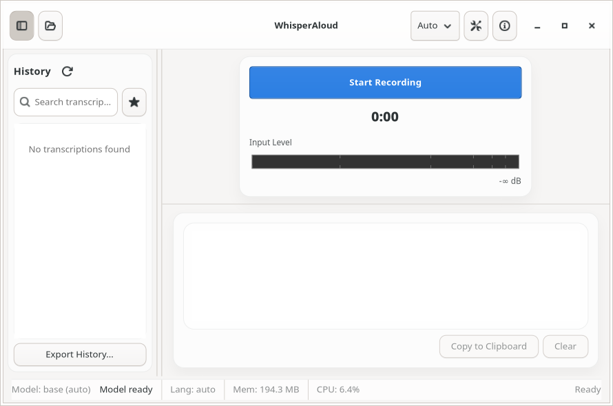
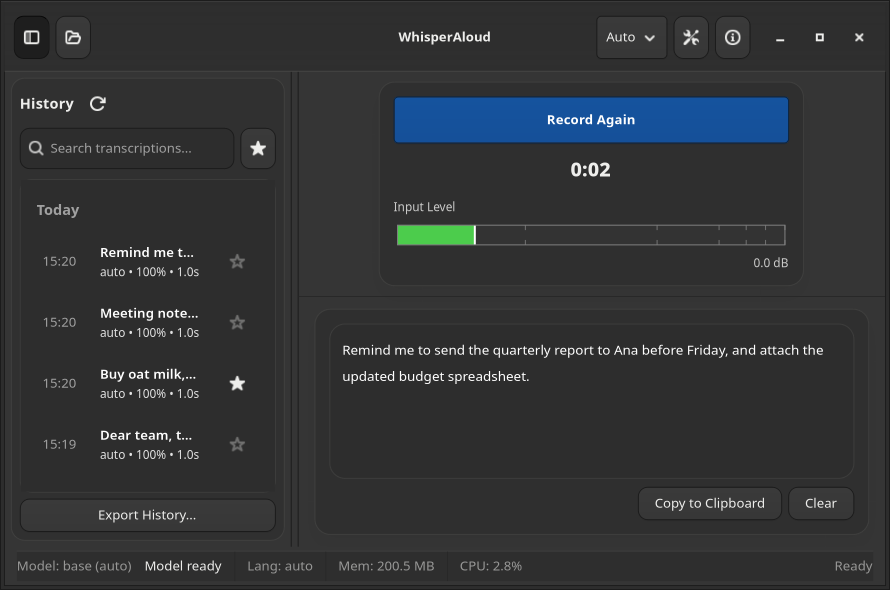

The same widget tree with only `Adw.init()` added, light and dark. The pill, flat header buttons and boxed
lists appear, and dark style is coherent:

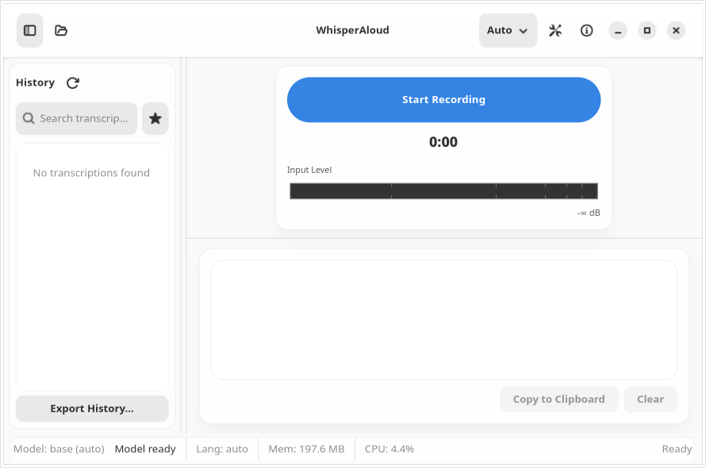
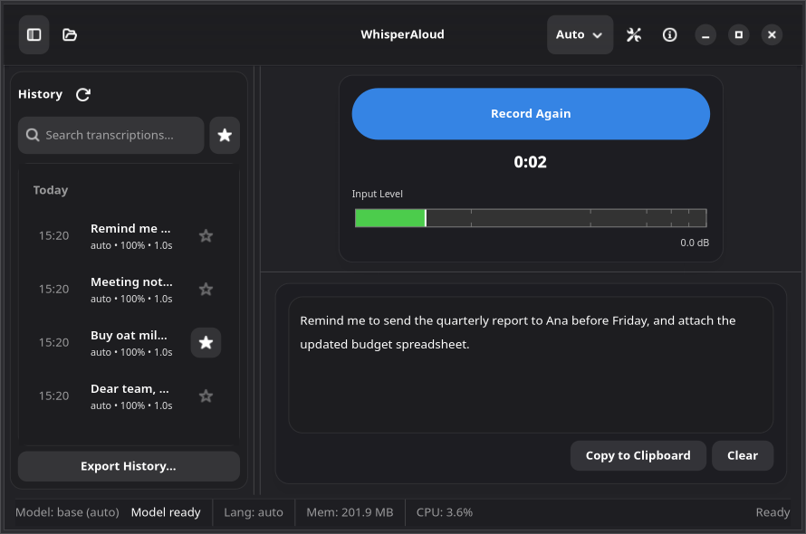

Settings boxed list without and with the libadwaita stylesheet. Without it, the `Adw.ComboRow`/`ExpanderRow`
rows have no row height or padding:

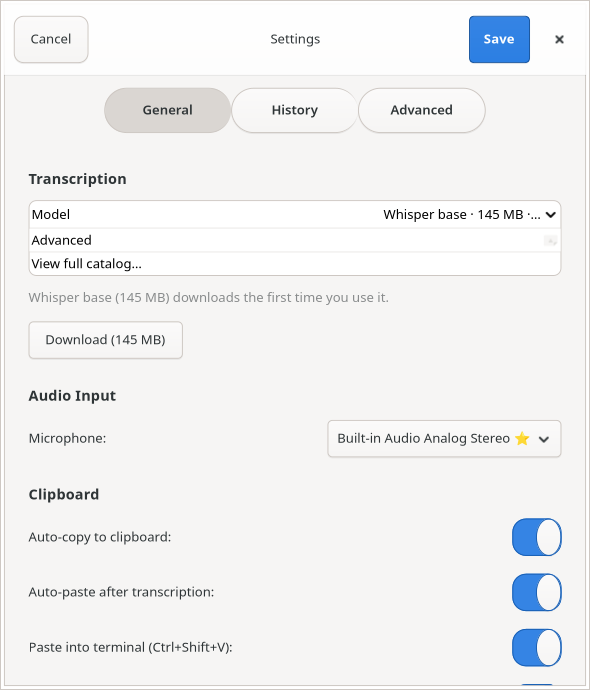
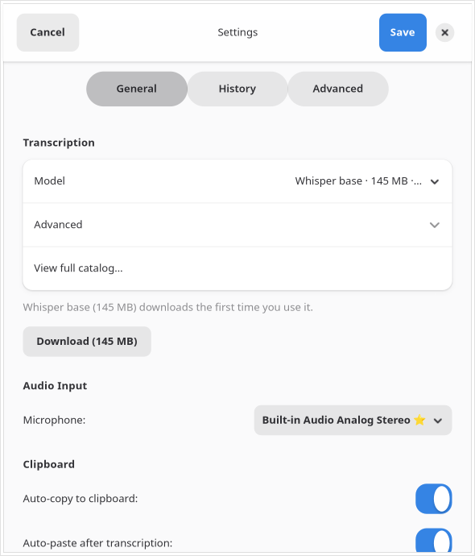

| ID | Current | HIG / API | Proposed | Effort | Prio |
|---|---|---|---|---|---|
| F-1 | `Gtk.Application` / `Gtk.ApplicationWindow`; libadwaita never initialized. Adw widgets are used in Settings but render unstyled | [AdwApplication](https://gnome.pages.gitlab.gnome.org/libadwaita/doc/main/class.Application.html) (loads the stylesheet, StyleManager, `style.css` resource) | `WhisperAloudApp(Adw.Application)`, `MainWindow(Adw.ApplicationWindow)`; content in `Adw.ToolbarView` with `Adw.HeaderBar` as top bar | S | P1 |
| F-2 | `ui/styles.py` (~200 lines) restyles header bar (gradient), surfaces (16 px radius, shadows), buttons (`wa-ghost`, `wa-primary-action` weight 650), history rows, paned handle; uses GTK3-era `@theme_*` colours | [UI styling](https://developer.gnome.org/hig/guidelines/ui-styling.html): use existing style classes and named colours; [style classes](https://gnome.pages.gitlab.gnome.org/libadwaita/doc/main/style-classes.html) | Delete almost all of it. Use `card`, `boxed-list`, `navigation-sidebar`, `view`, `frame`, `flat`, `pill`, `circular`, `numeric`, `dim-label`, `title-1..4`, `heading`, `caption`. Keep only what has no equivalent (e.g. the partial-transcript tag), written with libadwaita colour variables | S | P1 |
| F-3 | Dark style: shipped app depends on GTK settings, not the GNOME `color-scheme` preference. Level meter uses hard-coded cairo colours (dark bar even in light mode); tentative partial text hard-codes `#9a9996` | [AdwStyleManager](https://gnome.pages.gitlab.gnome.org/libadwaita/doc/main/class.StyleManager.html) follows the system preference | Comes with F-1. Draw the level from widget colours (or use `Gtk.LevelBar`, see M-6); compute the tentative-text colour from the widget's foreground with reduced alpha, not a literal | S | P2 |
| F-4 | Window title "WhisperAloud" only; no subtitle | [Header bars](https://developer.gnome.org/hig/patterns/containers/header-bars.html), [AdwWindowTitle](https://gnome.pages.gitlab.gnome.org/libadwaita/doc/main/class.WindowTitle.html) | `Adw.WindowTitle(title="WhisperAloud", subtitle=<model readiness>)`, e.g. "Whisper Base · Ready" or "Loading Model…" (see S-3) | S | P2 |
| F-5 | No About dialog | [Menus](https://developer.gnome.org/hig/patterns/controls/menus.html) ("About <App>" is a required primary-menu item); [AdwAboutDialog](https://gnome.pages.gitlab.gnome.org/libadwaita/doc/main/class.AboutDialog.html) | `Adw.AboutDialog.new_from_appdata("/…/metainfo.xml", version)`. Put model, device, engine, hotkey backend, daemon API version, memory/CPU in `debug_info` (moved out of the status bar), and link third-party model licences (`docs/THIRD_PARTY_MODELS.md`) via `add_legal_section` | S | P2 |

### 3.2 Header bar, primary menu, keyboard


| ID | Current | HIG / API | Proposed | Effort | Prio |
|---|---|---|---|---|---|
| H-1 | Six controls in the header: history toggle, open file (`document-open`), language `Gtk.DropDown`, settings (`preferences-system-symbolic`), shortcuts behind `help-about-symbolic` (an "info" icon), window controls | [Header bars](https://developer.gnome.org/hig/patterns/containers/header-bars.html): few controls, menus at the end; [Menus](https://developer.gnome.org/hig/patterns/controls/menus.html): primary menu `open-menu-symbolic`, tooltip "Main Menu" | Start: sidebar toggle. End: primary menu only. Language moves next to the record control (M-4). File transcription becomes a menu item, an empty-state button and drag-and-drop (T-1) | S | P1 |
| H-2 | No primary menu | [Menus](https://developer.gnome.org/hig/patterns/controls/menus.html) | `Gtk.MenuButton(icon="open-menu-symbolic", primary=True)` with sections: *Transcribe File…* (Ctrl+O), *Export History…*; then *Preferences* (Ctrl+,), *Keyboard Shortcuts* (Ctrl+?), *About WhisperAloud*. No Quit item (Ctrl+Q stays as an accelerator) | S | P1 |
| H-3 | Shortcuts are an `EventControllerKey` on the window (`_on_key_pressed`), not actions. Space toggles recording; **Esc clears the transcript** (destructive, no undo); **Ctrl+X cancels** (Ctrl+X is Cut); **F1 opens shortcuts** (F1 is Help); Ctrl+C is intercepted to copy all | [Keyboard](https://developer.gnome.org/hig/guidelines/keyboard.html), [standard keys](https://developer.gnome.org/hig/reference/keyboard.html) | `GAction`s on app/window with `set_accels_for_action`: `win.toggle-recording` (Space when not in text, plus Ctrl+R; to be decided), `win.cancel` (**Esc** while recording/transcribing), `win.copy-transcript` (Ctrl+Shift+C; plain Ctrl+C stays text copy), `win.transcribe-file` (Ctrl+O), `win.search-history` (Ctrl+F), `app.preferences` (Ctrl+,), `win.show-help-overlay` (Ctrl+?), `window.close` (Ctrl+W), `app.quit` (Ctrl+Q), F10 for the menu (built in). Remove Esc=Clear | M | P1 |
| H-4 | Shortcuts window: hand-built `Gtk.Window` with keycap labels; omits Ctrl+O; closes itself when it loses focus; 420×580, not resizable | [AdwShortcutsDialog](https://gnome.pages.gitlab.gnome.org/libadwaita/doc/main/class.ShortcutsDialog.html) (1.8); `GtkShortcutsWindow` (deprecated in 4.18, still present) | Build from one source of truth (the action/accel table): `Adw.ShortcutsDialog` when Adw ≥ 1.8, else `Gtk.ShortcutsWindow` from a `GtkBuilder` string set as `help-overlay`. Include the *global* shortcut as an informational item | S | P2 |

### 3.3 Dictation view (record control, transcript)

| Idle (empty) | Recording | Transcribing | Result |
|---|---|---|---|
|  |  | 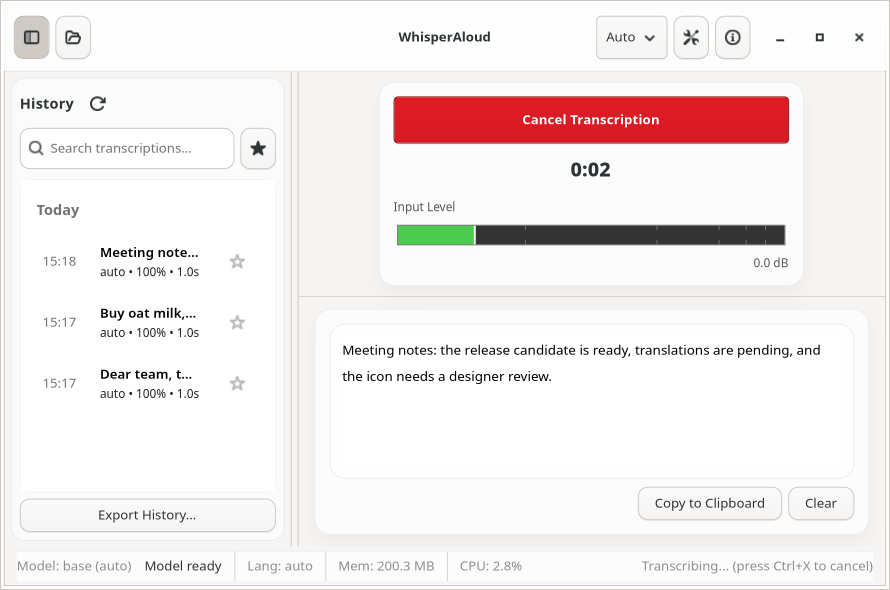 |  |

| ID | Current | HIG / API | Proposed | Effort | Prio |
|---|---|---|---|---|---|
| M-1 | One full-width 200×44 button changes label and colour per state: "Start Recording" (blue), "Stop Recording" (**red/destructive**), hidden and replaced by "Cancel Transcription" (**red**) of the same size, "Record Again", "Try Again" (in ERROR, which actually starts a new recording). `pill` has no effect when shipped (F-1) | [Buttons](https://developer.gnome.org/hig/patterns/controls/buttons.html): one suggested/destructive per view; stopping is not destructive | **Idle:** large `circular suggested-action` button (≈64 px, `media-record-symbolic` / `audio-input-microphone-symbolic`) with the label "Record" below, or a `pill suggested-action` "Record" (Sound Recorder pattern). **Recording:** same position becomes **Stop** (`media-playback-stop-symbolic`), styled `suggested-action` or with a red "recording" accent, plus a separate flat **Cancel** (Esc) that discards. **Transcribing:** `Adw.Spinner` + "Transcribing…" + flat Cancel. Labels never "Try Again"/"Record Again" | M | P1 |
| M-2 | The previous take's text stays in the transcript area while a new recording runs and while transcribing ([07](hig-audit/screenshots/07-recording.png), [08](hig-audit/screenshots/08-transcribing.png)). Partial text also persists after a reset ([19](hig-audit/screenshots/19-file-transcribing.png)) | [Placeholders](https://developer.gnome.org/hig/patterns/feedback/placeholders.html) | While recording, show the live partial transcript (streaming engines) or a placeholder ("Listening…"). Never show stale text. Clear the buffer on `_partial_view.reset()` | S | P1 |
| M-3 | Empty transcript is a blank bordered box; nothing tells a first-time user what to do or which global shortcut exists | [Placeholders](https://developer.gnome.org/hig/patterns/feedback/placeholders.html), [AdwStatusPage](https://gnome.pages.gitlab.gnome.org/libadwaita/doc/main/class.StatusPage.html) | `Adw.StatusPage(icon=app icon, title="Start Dictating", description="Press Record or use Super+Alt+R from any app. Text is copied to the clipboard.")` with a secondary "Transcribe a File…" button (`pill`). Description reflects the real configured shortcut and auto-paste settings | S | P1 |
| M-4 | Language selector in the header bar, far from the action it affects | [Header bars](https://developer.gnome.org/hig/patterns/containers/header-bars.html) | Small flat `Gtk.DropDown`/`MenuButton` beside the record control ("Auto-Detect Language ▾"), bound to `transcription.language`. Also a `ComboRow` in Preferences (same key, kept in sync via `ConfigChanged`). Remove the hidden `language_entry` in Settings | S | P2 |
| M-5 | Timer `title-2`, always visible (shows "0:02" from the last take while idle) | [Typography](https://developer.gnome.org/hig/guidelines/typography.html); `numeric` style class | Visible only while recording; `title-1` + `numeric` (tabular digits). Announce start/stop to AT (A-4) | S | P3 |
| M-6 | Level meter: custom cairo `DrawingArea`, 280–400 px fixed, "Input Level" caption, dB ticks and "0.0 dB" text, always visible (stale after a take) | [Progress bars](https://developer.gnome.org/hig/patterns/feedback/progress-bars.html) (closest pattern); `Gtk.LevelBar` is themed by Adwaita | Only while recording: a compact `Gtk.LevelBar` (continuous, offsets for high/full) or a theme-coloured waveform strip under the Stop button. Drop the dB scale and caption; keep "Input level" as the accessible label with `value-now` updates | S | P2 |
| M-7 | Copy / Clear: two framed text buttons under the text; "Copy to Clipboard" with no feedback beyond the status bar; Clear is irreversible | [Toasts](https://developer.gnome.org/hig/patterns/feedback/toasts.html) | Flat icon buttons in a small toolbar on the transcript card (`edit-copy-symbolic` "Copy", `user-trash-symbolic` "Delete" or `edit-clear-symbolic` "Clear"). Copy shows the toast "Copied to Clipboard"; Clear shows "Transcript cleared" with **Undo** | S | P2 |
| M-8 | Transcript area: `Gtk.TextView` in a rounded custom surface; editable only when history editing is enabled, saving silently after 1.5 s ("Saved" in the status bar) | [AdwClamp](https://gnome.pages.gitlab.gnome.org/libadwaita/doc/main/class.Clamp.html); `card` / `view` style classes | `Adw.Clamp` (max ≈ 720 sp) around a `card`-styled `Gtk.TextView` (`body` text, comfortable margins). No save toast for the debounce: autosave is expected to be silent; only failures get a toast | S | P3 |
| M-9 | Partial transcript: committed text normal, tentative text `#9a9996` ([18](hig-audit/screenshots/18-live-partial-transcript.png)) | F-3 | Same idea, theme-aware colour (dim foreground), and a subtle caret/ellipsis to signal "still listening" | S | P3 |

### 3.4 Status bar, feedback, model readiness

<a id="model-readiness"></a>

| Model loading | Model missing | Model error (window grows to 1056 px) |
|---|---|---|
| 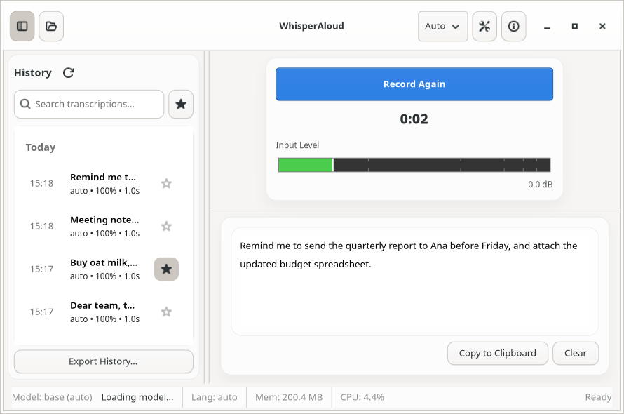 | 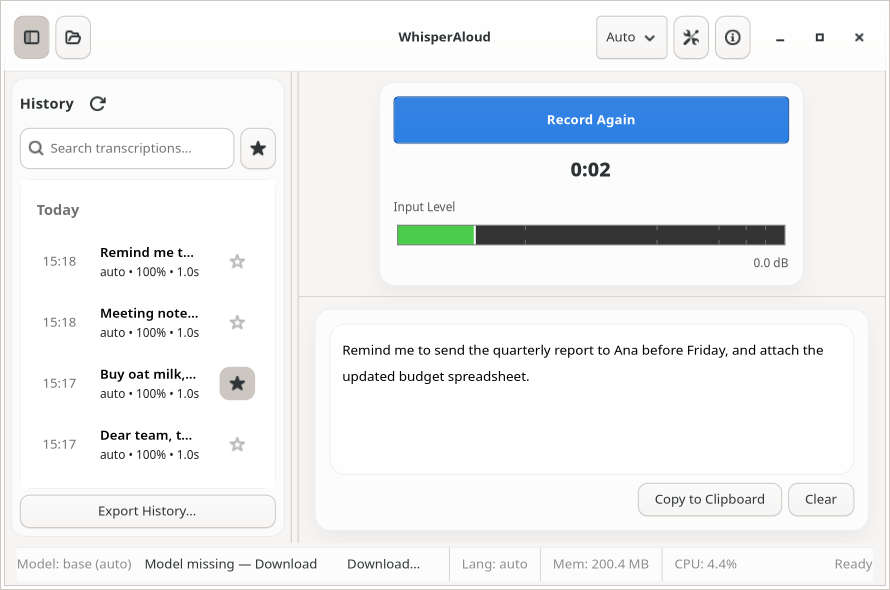 |  |

| Transcribing while the model loads | Error state | File job |
|---|---|---|
| 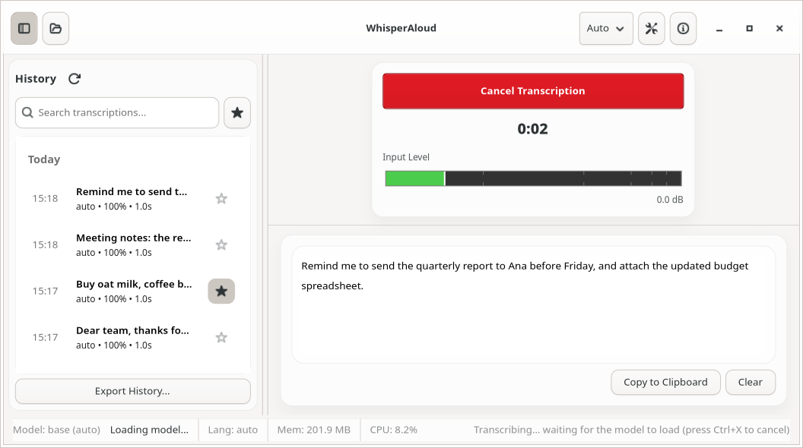 | 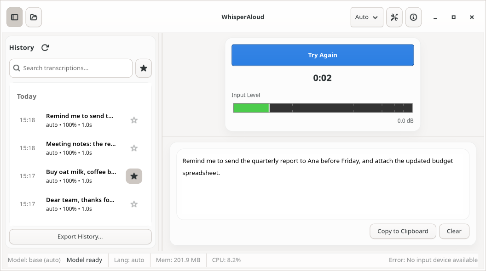 | 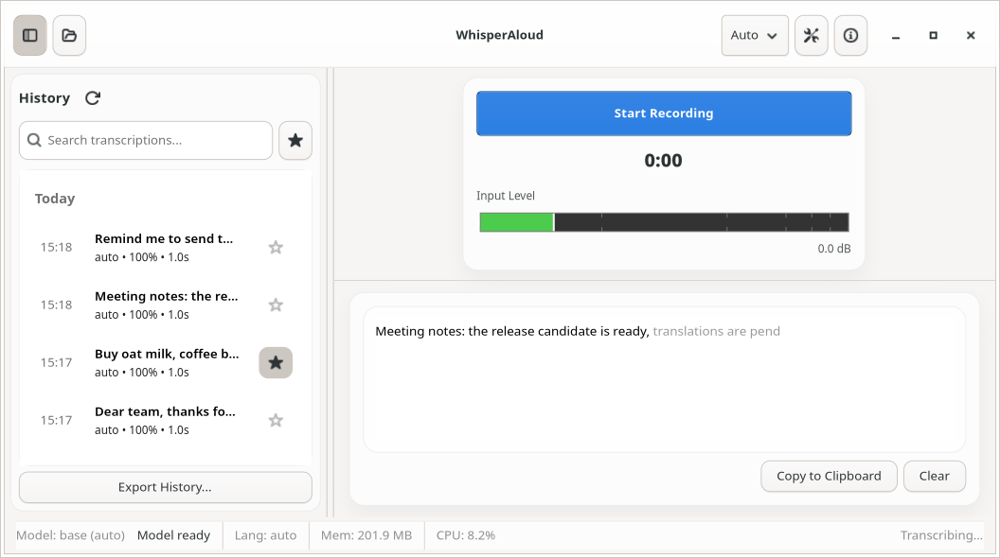 |

| ID | Current | HIG / API | Proposed | Effort | Prio |
|---|---|---|---|---|---|
| S-1 | Bottom `StatusBar`: "Model: base (auto)", model state, "Download…" button, "Lang: auto", "Mem: 200 MB", "CPU: 4.4%" (a psutil thread polling every 5 s), and a transient message auto-cleared after 4 s | No status bars in GNOME apps. [Toasts](https://developer.gnome.org/hig/patterns/feedback/toasts.html), [Banners](https://developer.gnome.org/hig/patterns/feedback/banners.html) | Remove it. Route each message by kind (S-2…S-5). Mem/CPU and model/device go to About → Troubleshooting (F-5). Language is shown on the language control (M-4) | M | P1 |
| S-2 | Transient confirmations ("Copied to clipboard", "Saved", "Ready (Confidence: 100%, Duration: 1.0s)", "Daemon rejected language update") are 4 s status-bar text, easy to miss and invisible to screen readers | [Toasts](https://developer.gnome.org/hig/patterns/feedback/toasts.html) | `Adw.ToastOverlay` around the content. Toasts for single events: "Copied to Clipboard", "Transcribed interview.m4a", "Couldn't change language", deletion with **Undo**. No toast for routine success ("Ready") | S | P1 |
| S-3 | Model readiness ("Loading model…", "Model ready", "Model missing — Download" followed by a "Download…" button with repeated wording, "Model error: …" truncated at 80 chars, which widens the window) | [Banners](https://developer.gnome.org/hig/patterns/feedback/banners.html) for persistent states; [Spinners](https://developer.gnome.org/hig/patterns/feedback/spinners.html) | **Ready / loading:** window subtitle (F-4), "Loading Model…" with no spinner in the header. If the user records while loading, the in-content transcribing state says "Waiting for the model to load…". **Missing:** `Adw.Banner("Speech model not downloaded", button "Download…")` opening Preferences → Speech Model. **Error:** `Adw.Banner("Couldn't load the speech model", button "Details")` → `Adw.AlertDialog` with the full error and a "Choose Another Model…" response. **Downloading:** banner "Downloading Whisper Base… 42%" (or a progress row in Preferences only) | M | P1 |
| S-4 | Errors (`Error` signal) set a red-free "Error: …" status text and switch the button to "Try Again" ([17](hig-audit/screenshots/17-error-state.png)) | [Dialogs](https://developer.gnome.org/hig/patterns/feedback/dialogs.html) vs [Toasts](https://developer.gnome.org/hig/patterns/feedback/toasts.html) | Recoverable, user-triggered failure (no mic, recording failed): toast with an action where useful ("No microphone found", button "Preferences"). Persistent failure (model, daemon): banner. Return the record control to Idle, never a "Try Again" state | S | P1 |
| S-5 | Progress text in the status bar ("Recording...", "Transcribing... (press Ctrl+X to cancel)", "Cancelling transcription...") | [Spinners](https://developer.gnome.org/hig/patterns/feedback/spinners.html) (3–30 s unknown progress) | In-content state under the record control (M-1). The cancel hint comes from the visible Cancel button and its tooltip "Cancel (Esc)" | S | P1 |
| S-6 | Desktop notifications (daemon) for start/stop/complete/error by default, even while the window is focused | [Notifications](https://developer.gnome.org/hig/patterns/feedback/notifications.html): only when the user is elsewhere; use a toast if relevant only while focused | When the GUI window is active, the GUI shows toasts and the daemon skips its notification (GUI tells the daemon its focus state, or the daemon checks a "window focused" hint). Notification titles in header caps; withdraw stale ones (e.g. "Recording…" once done). Default: notify only "Transcription Copied" and errors when unfocused | M | P2 |

### 3.5 Connection states (daemon)

| Retrying (status bar) | Unavailable (modal) | The modal itself |
|---|---|---|
| 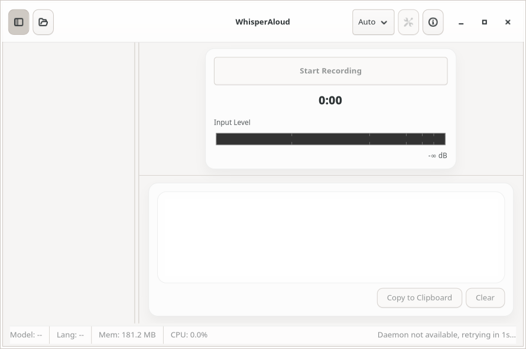 |  | 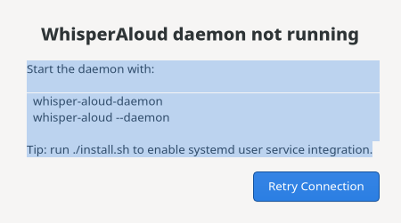 |

| ID | Current | HIG / API | Proposed | Effort | Prio |
|---|---|---|---|---|---|
| C-1 | Every connection attempt opens a modal, non-closable `Gtk.Window` "Connecting to WhisperAloud daemon..." with a pulsing `Gtk.ProgressBar` | [Dialogs](https://developer.gnome.org/hig/patterns/feedback/dialogs.html) (only in response to user action); [Spinners](https://developer.gnome.org/hig/patterns/feedback/spinners.html) | Window content `Gtk.Stack` with page "connecting": `Adw.StatusPage` + `Adw.Spinner` (`Gtk.Spinner` below 1.6), title "Starting…". Show it only after ~0.5 s without a connection (event-driven: `GLib.timeout_add` that is cancelled by the connected event, not a correctness gate), so fast connects don't flash | S | P1 |
| C-2 | Daemon unavailable: a second hand-built modal `Gtk.Window` titled "WhisperAloud - Daemon Not Running", with a selectable label whose whole text is **pre-selected** (focus lands on it), developer instructions (`./install.sh`, `whisper-aloud --daemon`) and "Retry Connection". Meanwhile the main window shows a disabled "Try Again" and an empty grey history pane | [Placeholders](https://developer.gnome.org/hig/patterns/feedback/placeholders.html); [Writing style](https://developer.gnome.org/hig/guidelines/writing-style.html) | `Adw.StatusPage(icon="dialog-warning-symbolic" or app icon, title="Background Service Not Running", description=<short, user-level hint>)` with a `pill suggested-action` "Retry" and a flat "Show Details" (`Adw.AlertDialog` with the selectable technical hint from `daemon_hints.py`). The sidebar shows nothing (collapse it) | M | P1 |
| C-3 | Daemon lost after connecting: same modal | [Banners](https://developer.gnome.org/hig/patterns/feedback/banners.html) | `Adw.Banner("Background service stopped", button "Restart")`. The last transcript and history stay readable; record is insensitive; auto-reconnect via `watch_name` hides the banner | S | P1 |
| C-4 | Wording: "daemon" everywhere in user-facing text | [Writing style](https://developer.gnome.org/hig/guidelines/writing-style.html) | "background service" (or just "WhisperAloud") in UI. Keep "daemon" in CLI/docs | S | P2 |

### 3.6 History panel

| Populated | Selection mode (right-click only) | Delete confirmation |
|---|---|---|
|  | 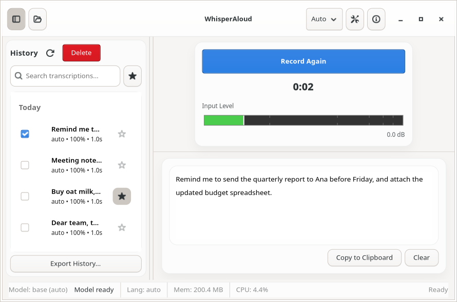 | 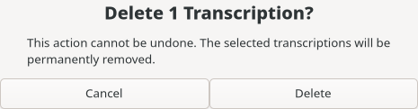 |

| ID | Current | HIG / API | Proposed | Effort | Prio |
|---|---|---|---|---|---|
| L-1 | `Gtk.Paned` (wide handle, position 225) with a custom rounded "History" card. Pane width shifts as content changes (compare [06](hig-audit/screenshots/06-idle-empty-history.png) and [07](hig-audit/screenshots/07-recording.png)); the toggle just removes the child | [Sidebars](https://developer.gnome.org/hig/patterns/nav/sidebars.html), [AdwOverlaySplitView](https://gnome.pages.gitlab.gnome.org/libadwaita/doc/main/class.OverlaySplitView.html) | `Adw.OverlaySplitView` (sidebar = history, `min/max-sidebar-width` ≈ 260–340 sp), sidebar `Adw.ToolbarView` with its own `Adw.HeaderBar` (title "History"), list in `navigation-sidebar` style. Collapses below the breakpoint (§4) | M | P2 |
| L-2 | Header row: "History" label, refresh button (manual refresh needed because there is no daemon push), and "Delete" shown in selection mode | [Selection mode](https://developer.gnome.org/hig/patterns/containers/selection-mode.html) | Remove refresh: add a `HistoryChanged(op, id)` daemon signal (small API bump) and refresh on it. Sidebar header end: search toggle (`system-search-symbolic`, Ctrl+F) and "Select" (`selection-mode-symbolic`). Selection mode replaces the header with "N Selected" and a bottom action bar (Delete, Star, Export) | M | P2 |
| L-3 | Always-visible `SearchEntry` + favourites toggle (`starred-symbolic`) | [Search](https://developer.gnome.org/hig/patterns/nav/search.html) | `Gtk.SearchBar` revealed by Ctrl+F, the toggle or type-to-search; live results (keep the debounce, shorten it to ~150 ms); "No Results Found" `StatusPage` (compact) on empty. Starred filter as a two-option `Adw.ToggleGroup` "All / Starred" (1.7, or a `Gtk.ToggleButton` pair below it) under the header | M | P2 |
| L-4 | Rows: time column, bold ellipsized first ~25 visible chars, meta line "auto • 100% • 1.0s", star toggle. Hover opens an upward monospace popover preview after 80 ms | [Boxed lists](https://developer.gnome.org/hig/patterns/containers/boxed-lists.html) / list views; [Writing style](https://developer.gnome.org/hig/guidelines/writing-style.html) | Row title: first line, up to 2 lines (`lines=2`, `ellipsize=END`). Subtitle: "15:18 · 12 s" (language only when not auto-detected; drop the confidence %, which is engine-dependent and meaningless with some engines). Flat star suffix. Remove the hover popover; full text appears on activation | S | P2 |
| L-5 | Activating a row **silently overwrites the clipboard** ("Copied to clipboard (Confidence…)") as well as loading it | Principle of least surprise; [Toasts](https://developer.gnome.org/hig/patterns/feedback/toasts.html) | Activation only loads the entry into the transcript view; copying is explicit (Copy button, context menu, Ctrl+Shift+C) | S | P1 |
| L-6 | Delete: the per-row `delete-requested` signal is connected but **never emitted** (dead path). The only delete path is right-click → selection mode → Delete → `Gtk.AlertDialog` (not Adw; "Cancel" default). There is no keyboard path | [Selection mode](https://developer.gnome.org/hig/patterns/containers/selection-mode.html); [Toasts](https://developer.gnome.org/hig/patterns/feedback/toasts.html) (Undo instead of confirmation) | Row context menu (right-click, long-press, Menu key, Shift+F10): Copy, Star/Unstar, Delete. Delete key on the focused row. Delete is immediate with a "Transcription deleted" toast + **Undo** (soft-delete in the GUI, commit on toast dismissal), so no confirm dialog | M | P2 |
| L-7 | Date group headers are fake non-selectable `ListBoxRow`s | `Gtk.ListBox.set_header_func` | Real list headers ("Today", "Yesterday", weekday, date) with the `heading` + `dim-label` classes | S | P3 |
| L-8 | Empty: "No transcriptions found" dim label in the list | [Placeholders](https://developer.gnome.org/hig/patterns/feedback/placeholders.html) | Compact `Adw.StatusPage` (`compact` style class, icon `document-edit-symbolic`, title "No Transcriptions Yet") | S | P3 |
| L-9 | "Export History..." full-width button at the bottom of the sidebar (ASCII dots, legacy `Gtk.FileChooserNative`, format picked by extension, silent success or failure) | [Menus](https://developer.gnome.org/hig/patterns/controls/menus.html), [Toasts](https://developer.gnome.org/hig/patterns/feedback/toasts.html) | Primary-menu item "Export History…" → `Gtk.FileDialog.save` (filters JSON/Markdown/CSV/Text) → toast "History exported" with "Open Folder"; failure toast with the reason. Same action from the selection-mode bar for "export selected" | S | P3 |

### 3.7 File transcription

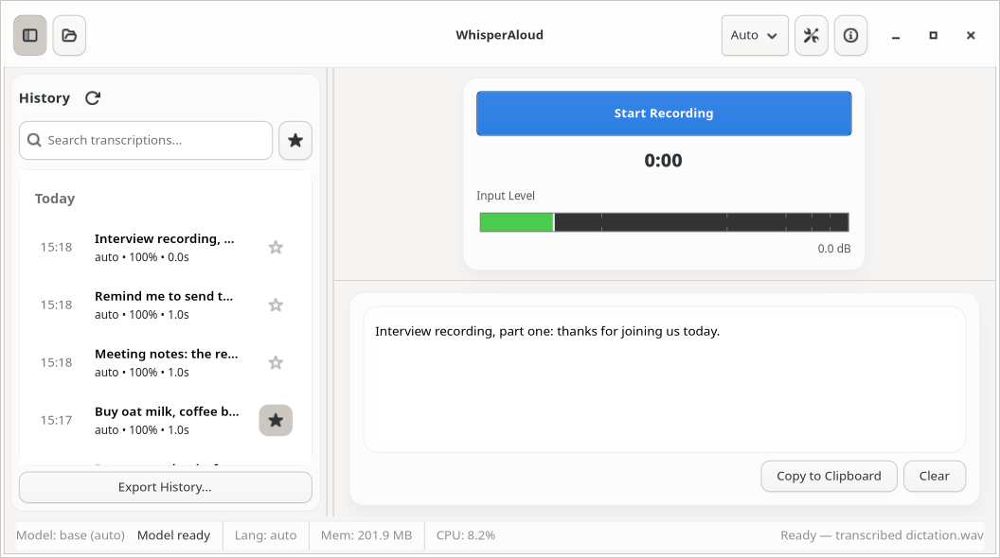

| ID | Current | HIG / API | Proposed | Effort | Prio |
|---|---|---|---|---|---|
| T-1 | Entry points: an unlabelled `document-open-symbolic` header button (sensitive even while disconnected), Ctrl+O, drag-and-drop anywhere (no drop feedback), "Open With" | [Header bars](https://developer.gnome.org/hig/patterns/containers/header-bars.html) | Primary-menu "Transcribe File…" (Ctrl+O); empty-state secondary button (M-3); drop target with a visual overlay (dimmed content + `Adw.StatusPage` "Drop to Transcribe", the pattern GNOME apps such as Loupe/Text Pieces use); keep "Open With". Disable the action while disconnected | S | P2 |
| T-2 | Progress only in the status bar ("Transcribing…"; the progress signal overwrites the "Transcribing interview.m4a…" label, so the file name disappears). Mic UI still says "Start Recording". No cancel (no `CancelFileTranscription` D-Bus method) | [Spinners](https://developer.gnome.org/hig/patterns/feedback/spinners.html) / [Progress bars](https://developer.gnome.org/hig/patterns/feedback/progress-bars.html) | In-content job card: file name, stage text ("Decoding…", "Transcribing…"), `Adw.Spinner` (or a progress bar if the daemon gains a fraction), Cancel (needs a new daemon method). On finish: result in the transcript view + toast "Transcribed interview.m4a"; on error: banner or toast with the reason | M | P2 |

### 3.8 Settings → Preferences

As shipped (full length, three tabs):

| General | History | Advanced |
|---|---|---|
| 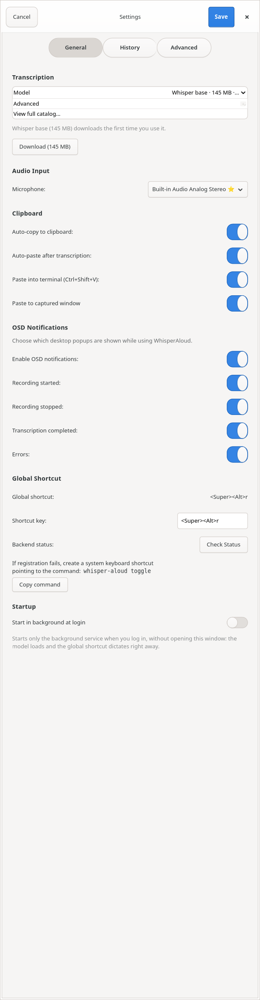 | 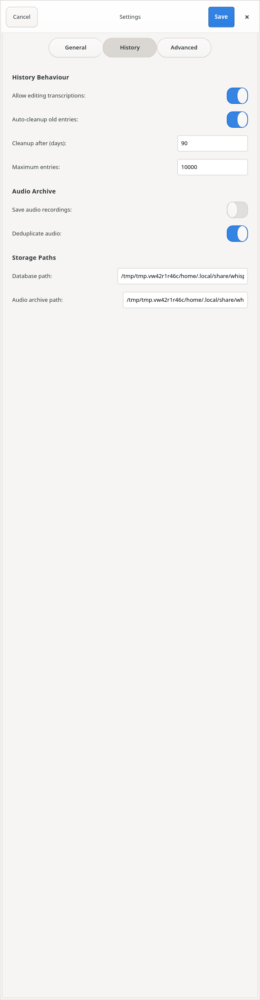 | 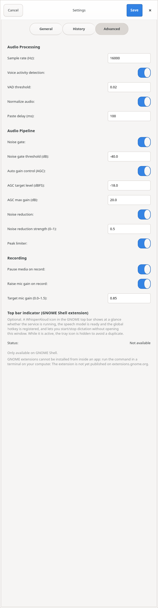 |

| Model "Advanced" expanded | Model catalog window | Unsaved-changes guard | Save confirmation |
|---|---|---|---|
| 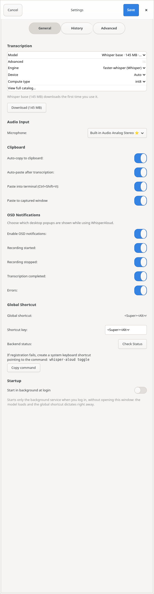 | 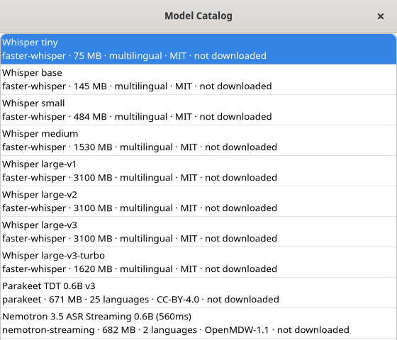 |  | 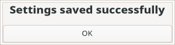 |

| ID | Current | HIG / API | Proposed | Effort | Prio |
|---|---|---|---|---|---|
| P-1 | `Gtk.Window` "Settings", non-modal, 600×700, `Gtk.StackSwitcher` pills (General / History / Advanced) inside a scrolled window, header **Cancel** / **Save**. Ctrl+S saves, Esc cancels, an unsaved-changes guard, and a modal "Settings saved successfully" + OK that also closes the window | [Windows → secondary windows](https://developer.gnome.org/hig/patterns/containers/windows.html); [AdwPreferencesDialog](https://gnome.pages.gitlab.gnome.org/libadwaita/doc/main/class.PreferencesDialog.html) | `Adw.PreferencesDialog` (title "Preferences", `search-enabled`), pages with icons, **instant apply**: each row writes its key through `client.set_config({key: value})`, reverts with a toast if the daemon rejects it, and updates when `ConfigChanged` arrives. Remove Cancel/Save, the dirty tracker, the discard dialog and the success alert (≈300 lines) | L | P1 |
| P-2 | Rows are `Gtk.Box(Label + Switch/Entry/DropDown)` with trailing colons ("Auto-copy to clipboard:") and no label↔control relation (switches have no accessible name; A-1) | [Boxed lists](https://developer.gnome.org/hig/patterns/containers/boxed-lists.html); [Writing style](https://developer.gnome.org/hig/guidelines/writing-style.html) | `Adw.SwitchRow` / `Adw.ComboRow` / `Adw.SpinRow` / `Adw.ActionRow` in `Adw.PreferencesGroup`s; title in header caps, explanation in `subtitle` (not tooltips). No colons | (in P-1) | P1 |
| P-3 | Numeric values in free-text `Gtk.Entry` validated on Save (sample rate, VAD threshold, paste delay, gate/AGC dB values, denoise strength, mic gain, cleanup days, max entries) | [AdwSpinRow](https://gnome.pages.gitlab.gnome.org/libadwaita/doc/main/class.SpinRow.html) | `Adw.SpinRow` with the same ranges as `InputValidator` (units in the subtitle, e.g. "Milliseconds", "dBFS"); validation becomes structurally impossible to fail | (in P-1) | P1 |
| P-4 | Model: `ComboRow` whose label crams "Whisper base · 145 MB · …" (truncated). Below the list float a dim "downloads the first time" note, a "Download (145 MB)" button, a progress bar, an error label, a licence note and a language-fallback note. "View full catalog…" opens a separate window with an **empty header bar**. Engine/Device/Compute in an "Advanced" expander | [AdwPreferencesDialog.push_subpage](https://gnome.pages.gitlab.gnome.org/libadwaita/doc/main/method.PreferencesDialog.push_subpage.html); [Boxed lists](https://developer.gnome.org/hig/patterns/containers/boxed-lists.html) | Group "Speech Model": one `Adw.ActionRow` "Model" with subtitle "Whisper Base · 145 MB · Downloaded" and a chevron that **pushes a subpage** listing catalog entries as rows (check-mark prefix for the active one; subtitle with engine · size · languages · licence; suffix "Download" button or progress or a "Downloaded" label; a toggle "Show All Models" replaces the separate catalog window and the language-fallback note). Licence consent stays an `Adw.AlertDialog`. Device and compute type move to an "Advanced" group on that subpage | L | P1 |
| P-5 | Microphone `Gtk.DropDown` marks the default with a ⭐ emoji | Writing style | `ComboRow` "Microphone" whose first item is "System Default" (stores `None`, the existing semantics), then devices | S | P2 |
| P-6 | Clipboard: 4 sibling switches ("Auto-copy", "Auto-paste after transcription", "Paste into terminal (Ctrl+Shift+V)", "Paste to captured window"); paste delay is in Advanced → Audio Processing | Grouping by task | Group "After Transcribing": SwitchRow "Copy to Clipboard"; `Adw.ExpanderRow` "Paste Into Active Window" with `show-enable-switch` containing "Use Terminal Shortcut (Ctrl+Shift+V)", "Paste Into Window Where Recording Stopped", SpinRow "Paste Delay" | S | P2 |
| P-7 | "OSD Notifications": master switch plus four children that gray out. "OSD" is jargon and wrong (these are desktop notifications) | [Notifications](https://developer.gnome.org/hig/patterns/feedback/notifications.html) | `Adw.ExpanderRow` "Notifications" (enable switch) with SwitchRows "Recording Started", "Recording Stopped", "Transcription Ready", "Errors". Consider dropping per-event toggles after S-6 | S | P2 |
| P-8 | Global shortcut: a read-only "Global shortcut: <Super><Alt>r" row, a free-text accelerator entry with GTK accel syntax, "Backend status:" + "Check Status" button that creates a new D-Bus client, help text with a "Copy command" button | [Keyboard](https://developer.gnome.org/hig/guidelines/keyboard.html); GlobalShortcuts portal | Row "Dictation Shortcut": suffix keycap (`Adw.ShortcutLabel` on 1.8+, a `keycap`-styled label otherwise) + "Change…" opening the **portal's** shortcut configuration (GlobalShortcuts `ConfigureShortcuts`, v2) when available, else a capture dialog. Live status as the subtitle from `HotkeyStateChanged` ("Active through the desktop portal", "Not available: set up a custom shortcut in Settings → Keyboard"). The fallback command in an expander with a copy button. No "Check Status" button | M | P2 |
| P-9 | Startup section (good: applies immediately via the Background portal) built from raw boxes | Background portal | `Adw.SwitchRow` "Run in Background at Login" with the existing subtitle and status, in group "Desktop Integration" | S | P2 |
| P-10 | "Top bar indicator (GNOME Shell extension)" lives at the bottom of **Advanced**, a long paragraph plus status | — | Group "Desktop Integration" on the General page: ActionRow "Top Bar Indicator", subtitle = status, suffix button (Enable/Install instructions → `Adw.AlertDialog` with the command). Hidden when not on GNOME Shell | S | P3 |
| P-11 | History page: "History Behaviour" (British spelling; the rest is US), raw path entries for DB and audio archive (meaningless inside Flatpak), "Cleanup after (days)" stays sensitive when auto-cleanup is off | [Writing style](https://developer.gnome.org/hig/guidelines/writing-style.html) | Page "History": group "History" (SwitchRow "Allow Editing", ExpanderRow "Delete Old Transcriptions" with SpinRow "After" days, SpinRow "Keep at Most"); group "Recordings" (SwitchRow "Keep Audio Recordings", "Skip Duplicate Audio"); group "Storage": ActionRows showing locations with an "Open Folder" button (no editable paths; editing moves to config/CLI). Add a destructive ButtonRow "Delete All History…" (Adw ≥ 1.6, else ActionRow + button) with confirmation | M | P2 |
| P-12 | Advanced: "Audio Processing" mixes sample rate, VAD, normalize, paste delay; "Audio Pipeline" lists 8 gate/AGC/denoise/limiter controls; "Recording" has pause media / raise mic gain / target gain | Progressive disclosure | Page "Audio": group "Input" (Microphone, SwitchRow "Pause Media While Recording", ExpanderRow "Raise Microphone Volume" + SpinRow target); group "Processing" with one `ExpanderRow` per stage, each with an enable switch and its SpinRows (Noise Gate, Automatic Gain, Noise Reduction, Peak Limiter), plus "Voice Detection". Sample rate should not be user-facing (the pipeline expects 16 kHz); keep it as a config/CLI key. "Normalize audio" vs AGC overlap needs a product decision (see memory note *normalize input before processing*) | M | P2 |

### 3.9 Adaptive width

| Requested 360 px → actual 775 px | History hidden, min 577 px |
|---|---|
| 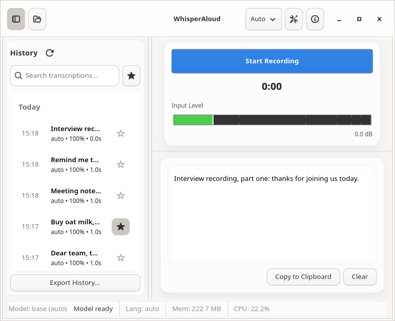 | 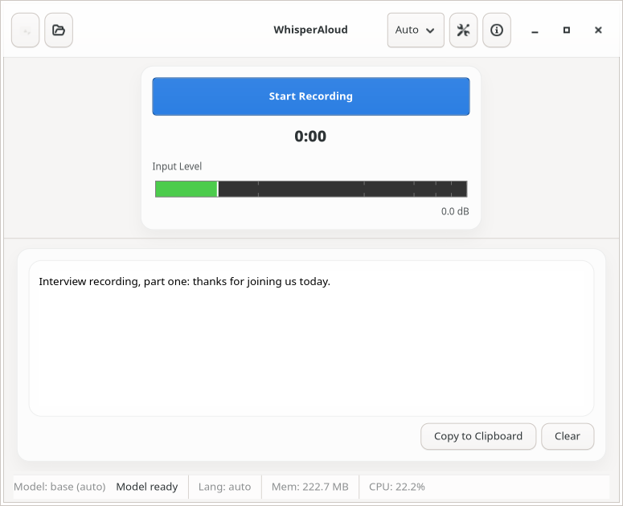 |

Measured (`metrics.json`): minimum width **785 px** (history shown) and **577 px** (hidden); minimum height
490 px. Metainfo says `<display_length compare="ge">360</display_length>`.

| ID | Current | HIG / API | Proposed | Effort | Prio |
|---|---|---|---|---|---|
| W-1 | Fixed size requests: record/cancel 200×44, level meter 280 (content 400), content pane 300, history 180, plus status-bar labels | [Scaling & adaptiveness](https://developer.gnome.org/hig/guidelines/adaptive.html) (360×294 minimum), [AdwBreakpoint](https://gnome.pages.gitlab.gnome.org/libadwaita/doc/main/class.Breakpoint.html) | Remove all size requests; rely on `Adw.Clamp` and natural sizes. `Adw.Breakpoint("max-width: 600sp")` sets `OverlaySplitView.collapsed=True` (the sidebar overlays and opens from the header toggle), and the record control shrinks to the circular-only variant. Set `width-request=360, height-request=294` on the window. Verify at 360×640 with the capture script | M | P2 |
| W-2 | Window default size 900×600 is not remembered | [Windows](https://developer.gnome.org/hig/patterns/containers/windows.html) (restore size on relaunch) | Persist width/height/maximized/sidebar-shown (GSettings or the GUI's own state file; the daemon config is the wrong place) | S | P3 |

### 3.10 Accessibility

| ID | Current | HIG / API | Proposed | Effort | Prio |
|---|---|---|---|---|---|
| A-1 | Settings switches and entries are siblings of plain labels, with no `labelled-by` relation. Screen readers announce "switch, on" with no name (only the Startup switch sets `LABEL`) | [Accessibility](https://developer.gnome.org/hig/guidelines/accessibility.html) | Solved structurally by Adw rows (P-2). Until then, `update_relation(LABELLED_BY)` | (P-1) | P1 |
| A-2 | Icon-only buttons rely on tooltips; the level meter `DrawingArea` has no role or value; history row star toggles say "Toggle favorite" | Accessibility | Explicit accessible labels ("Show History", "Main Menu", "Star", "Unstar"); the level meter gets a `Gtk.AccessibleRole.METER` with value updates (free with `Gtk.LevelBar`) | S | P2 |
| A-3 | Right-click is the only way into selection mode; hover is the only way to preview | Accessibility, [Selection mode](https://developer.gnome.org/hig/patterns/containers/selection-mode.html) | L-2, L-4, L-6 | (L) | P2 |
| A-4 | State changes (recording started/stopped, transcription ready, errors) are only visual or sound | `Gtk.Accessible.announce()` (GTK ≥ 4.14) | Announce "Recording", "Transcribing", "Transcription ready, copied to clipboard"; toasts are announced by libadwaita | S | P2 |
| A-5 | Daemon-unavailable dialog: focus lands on a selectable label, so the whole hint shows selected ([05](hig-audit/screenshots/05-daemon-unavailable-dialog.png)) | — | Replaced by C-2. If a selectable label stays, give the button initial focus | S | P3 |

### 3.11 Writing style and consistency

Per [Writing style](https://developer.gnome.org/hig/guidelines/writing-style.html):
- **Header capitalization** applies to header-bar, tab and view titles, button and switch labels, menu items,
  tooltips, and short labels that are not sentences.
- **Sentence capitalization** applies to text-entry and combo labels, and to body text in dialogs and
  notifications.
- Use "…" only when the action needs more input.

| Current | Issue | Proposed |
|---|---|---|
| "Start Recording" / "Stop Recording" / "Record Again" / "Try Again" / "Cancel Transcription" | One button, five meanings | "Record" / "Stop" / "Cancel" (M-1) |
| "Copy to Clipboard", "Clear" | Verbose; Clear is irreversible | "Copy" (tooltip "Copy to Clipboard"), "Clear" with Undo |
| "Export History...", "Search transcriptions...", "Daemon is starting, please wait...", "Cancelling..." | ASCII "..." mixed with "…" elsewhere | Always "…"; drop "please wait" |
| "Settings" (window, tooltip) | GNOME uses "Preferences" for app settings ([Menus](https://developer.gnome.org/hig/patterns/controls/menus.html)) | "Preferences" |
| "OSD Notifications", "Enable OSD notifications:" | Jargon, wrong term, colon | "Notifications" |
| "Auto-copy to clipboard:", "Microphone:", "Shortcut key:", "Backend status:" … | Trailing colons; sentence case on switch titles | Header caps, no colons ("Copy to Clipboard", "Microphone") |
| "History Behaviour" vs "Normalize" | Mixed GB/US spelling | US English throughout (matches the GNOME source language) |
| "WhisperAloud daemon not running", "Retry Connection", "Daemon disconnected", "Not connected to daemon" | Internal architecture term | "Background Service Not Running", "Retry", "Background service stopped" |
| "Ready (Confidence: 100%, Duration: 1.0s)" | Telemetry as status | Nothing (the result is visible); duration in the history row subtitle |
| "Model missing — Download" + "Download…" button | Repeated verb | Banner "Speech model not downloaded" + "Download…" |
| "Paste to captured window" | Implementation term | "Paste Into Window Where Recording Stopped" (subtitle explains) |
| "Fake (test only)" | Shown only under `WHISPER_ALOUD_TEST_MODE=1` — correct, not a finding | — |

### 3.12 App icon, desktop entry, metainfo


(Left to right: WhisperAloud at 128, 64 and 32 px; GNOME Sound Recorder at 128 px.)

| ID | Current | HIG / API | Proposed | Effort | Prio |
|---|---|---|---|---|---|
| I-1 | 128-px grid-aware icon (good: base with a 4-px darker bottom edge). It is a white mic glyph with waveform bars on a blue rounded square: a "glyph on a tile" iOS/Android pattern rather than GNOME's object-metaphor style. The waveform bars turn to noise at 32 px; a mic is the same metaphor as Sound Recorder and many recorders, and says nothing about *text* | [App icons](https://developer.gnome.org/hig/guidelines/app-icons.html) | File a request with the GNOME design team's app-icon process (`gitlab.gnome.org/Teams/Design/app-icon-requests`) or a designer. Brief: an object metaphor combining voice and text (e.g. a sheet or speech bubble with lines of text emerging from a sound wave), GNOME palette, legible at 32 px. The header comment already flags it as a placeholder | M (external) | P2 |
| I-2 | **No symbolic icon** (`org.fede.whisperaloud-symbolic.svg`) | [App icons](https://developer.gnome.org/hig/guidelines/app-icons.html) ("each app should have an additional symbolic version") | Add `data/icons/hicolor/symbolic/apps/org.fede.whisperaloud-symbolic.svg` (16 px), and use it for the Shell indicator and the Background Apps list | S | P2 |
| I-3 | GApplication ID `org.fede.whisperaloud.Gui` (it must differ from the daemon's bus name) vs desktop file `org.fede.whisperaloud.desktop`. In the Flatpak, Shell matches windows through the sandbox app ID. For the **native .deb**, the Wayland `app_id` is `org.fede.whisperaloud.Gui`, which has no desktop file, so the dash and Alt+Tab may show a generic icon and a separate "running app" (needs verification on a live session; it cannot be checked headless) | Desktop Entry spec, `StartupWMClass` | Add `StartupWMClass=org.fede.whisperaloud.Gui` to `data/org.fede.whisperaloud.desktop` and verify in GNOME (dash icon, Alt+Tab, pinned favourite). Remove the stale legacy `com.whisperaloud.App.desktop` at the repo root (it is not used by packaging; it uses `Icon=audio-input-microphone` and actions that open a terminal) | S | P1 |
| I-4 | Metainfo screenshot URLs point to `docs/screenshots/*.png`, which does not exist yet | Flathub requirement | After the redesign, generate them with this capture harness (light, 16:9-ish, default size, real-looking text), commit them, and add captions | S | P2 |
| I-5 | Desktop actions use absolute `/usr/bin/whisper-aloud` | Flatpak rewrites Exec; native is fine | Keep. Add `X-GNOME-UsesNotifications=true` (the daemon sends notifications) | S | P3 |

### 3.13 Tray icon and GNOME Shell extension

| ID | Current | HIG / API | Proposed | Effort | Prio |
|---|---|---|---|---|---|
| X-1 | Extension: a `PanelMenu.Button` that is **always present**, even when the app is not running (`microphone-disabled-symbolic`), with a popup of four non-reactive status lines, "Toggle Recording", "Start WhisperAloud" and "Open WhisperAloud" | [gjs.guide Quick Settings](https://gjs.guide/extensions/topics/quick-settings.html); Shell shows indicators only for active state (cf. screen recording, Night Light) | Use `QuickSettings.SystemIndicator` + a `QuickMenuToggle` "Dictation" (subtitle "Ready", "Recording", "Model loading"; toggle = start/stop recording; menu: status, "Open WhisperAloud", "Preferences"). Show the panel icon (`_addIndicator`) only while recording or transcribing, or on error. No icon when idle or not running | M | P2 |
| X-2 | Icon map: transcribing = `system-run-symbolic` (gears), loading = `content-loading-symbolic`, recording = `media-record-symbolic` in hard-coded `#e01b24`, degraded = hard-coded `#e5a50a` | [UI icons](https://developer.gnome.org/hig/guidelines/ui-icons.html) | Recording: the app's own symbolic (I-2) or `audio-input-microphone-symbolic`, red only while recording (the Shell privacy-indicator convention). Transcribing: the same icon pulsing, or `content-loading-symbolic`. Drop the "degraded" amber icon; put that detail in the Quick Settings subtitle | S | P3 |
| X-3 | GNOME Shell already shows its own microphone privacy indicator while any app records | — | Accept the overlap (ours adds app state) but don't duplicate when idle (X-1) | — | P3 |
| X-4 | Daemon's AppIndicator tray (Ayatana) on GNOME: not shown without the AppIndicator extension; it is hidden automatically when our extension is active | GNOME 44+ Background Apps in Quick Settings | Keep for KDE and others. On GNOME rely on the Background Apps list (Flatpak) + extension. Call Background portal **`SetStatus`** (v2, ≤ 96 chars), e.g. "Ready — Super+Alt+R to dictate" or "Recording…", so the Background Apps entry is informative | S | P2 |

---

## 4. Target layout

### 4.1 Main window, wide (≥ 600 sp)

```
┌────────────────────┬─────────────────────────────────────────────────────────┐
│ [◧]   History  [🔍][☑]│              WhisperAloud                       [☰] ─ □ ✕│
│                    │           Whisper Base · Ready                          │
├────────────────────┤ ┌─ Adw.Banner (only when needed) ──────────────────────┐│
│ ( All | Starred )  │ │ Speech model not downloaded            [Download…]   ││
│                    │ └──────────────────────────────────────────────────────┘│
│ Today              │                                                         │
│ ┌────────────────┐ │                       ╭──────╮                          │
│ │Remind me to se…│ │                       │  ●   │  ← circular, suggested   │
│ │15:18 · 6 s   ☆ │ │                       ╰──────╯                          │
│ ├────────────────┤ │                        Record                           │
│ │Meeting notes: …│ │            Auto-Detect Language ▾                       │
│ │15:18 · 9 s   ★ │ │                                                         │
│ ├────────────────┤ │   ┌─ card (Adw.Clamp 720) ───────────────────────────┐  │
│ │Buy oat milk, c…│ │   │ Remind me to send the quarterly report to Ana    │  │
│ │15:17 · 4 s   ☆ │ │   │ before Friday, and attach the updated budget …   │  │
│ └────────────────┘ │   │                                    [⧉ Copy] [⌫]  │  │
│ Yesterday          │   └──────────────────────────────────────────────────┘  │
│ …                  │                     ┌ toast: Copied to Clipboard ┐      │
└────────────────────┴─────────────────────────────────────────────────────────┘
 Adw.OverlaySplitView (sidebar: ToolbarView+HeaderBar+SearchBar+ListBox, navigation-sidebar)
 content: ToolbarView(HeaderBar[WindowTitle], Banner) → ToastOverlay → Gtk.Stack{connecting,
 unavailable, empty(StatusPage), dictation}
```

**Recording / transcribing** (the record area only; nothing else moves):
```
        ╭──────╮                                   ◌  (Adw.Spinner)
        │  ■   │  Stop (Space)                   Transcribing…
        ╰──────╯                                   [ Cancel ]   (flat, Esc)
          0:07          (title-1, numeric)
   ▁▂▅▇▅▃▂▁▂▄▆▅▂  (LevelBar / waveform, theme colours)
        [ Cancel ]  (flat, Esc)
   ┌ card ───────────────────────────────┐
   │ Meeting notes: the release candidate│
   │ is ready, translations are pend…    │  ← live partial (dim tail) or "Listening…"
   └─────────────────────────────────────┘
```

**Empty / first run:**
```
                      [app icon]
                   Start Dictating
   Press Record or use Super+Alt+R in any app.
   The text is copied to the clipboard.
              ( Transcribe a File… )
```

**Connecting / unavailable** (replace the whole content, sidebar collapsed):
```
        ◌                                     ⚠
     Starting…                 Background Service Not Running
                               WhisperAloud's background service did not start.
                                    (  Retry  )   Show Details
```

### 4.2 Main window, narrow (< 600 sp, down to 360)

```
┌──────────────────────────────┐
│ [◧]   WhisperAloud       [☰] │   sidebar collapsed; [◧] slides History over content
│     Whisper Base · Ready     │
├──────────────────────────────┤
│           ╭────╮             │
│           │ ●  │  Record     │
│           ╰────╯             │
│   Auto-Detect Language ▾     │
│ ┌ card ────────────────────┐ │
│ │ Remind me to send the …  │ │
│ │              [⧉] [⌫]     │ │
│ └──────────────────────────┘ │
└──────────────────────────────┘
```

### 4.3 Primary menu

```
Transcribe File…        Ctrl+O
Export History…
───────────────────────────────
Preferences             Ctrl+,
Keyboard Shortcuts      Ctrl+?
About WhisperAloud
```

### 4.4 Preferences (`Adw.PreferencesDialog`, search enabled, instant apply)

```
[ General ] [ Audio ] [ History ]           (page switcher is built in; icons + titles)

General
  Speech Model
    Model                    Whisper Base · 145 MB · Downloaded            ›   → subpage
    Language                 Auto-Detect                                    ▾
  After Transcribing
    Copy to Clipboard                                                     [on]
    Paste Into Active Window                                       ⌄      [on]
      Use Terminal Shortcut (Ctrl+Shift+V)                                [off]
      Paste Into Window Where Recording Stopped                           [on]
      Paste Delay                         milliseconds          [ 100 − + ]
  Notifications                                                    ⌄      [on]
      Recording Started / Recording Stopped / Transcription Ready / Errors
  Desktop Integration
    Dictation Shortcut       Active through the desktop portal   [Super+Alt+R] Change…
    Run in Background at Login   Loads the model at login so dictation is instant [off]
    Top Bar Indicator        Enabled · version 4                          ›   (GNOME only)

Speech Model (subpage)
  [ All Models  ⟷  For My Language ]  (or a "Show All Models" switch)
  ✓ Whisper Base         faster-whisper · 145 MB · 99 languages · MIT    Downloaded
    Whisper Small        faster-whisper · 466 MB · 99 languages · MIT    [Download]
    Parakeet TDT 0.6B    sherpa-onnx · 640 MB · English · CC-BY-4.0      ▓▓▓░░ 42% [✕]
    Nemotron Streaming   sherpa-onnx · … · OpenMDW (review pending)      [Download…] → licence AlertDialog
  Advanced
    Engine  ▾   Device ▾   Compute Type ▾

Audio
  Input
    Microphone               System Default                                 ▾
    Pause Media While Recording                                            [on]
    Raise Microphone Volume                                       ⌄        [on]
      Target Level                                       [ 0.85 − + ]
  Processing
    Voice Detection                                                ⌄       [on]
      Threshold                                          [ 0.02 − + ]
    Noise Gate                                                     ⌄       [on]
      Threshold                         dB               [ −40 − + ]
    Automatic Gain                                                 ⌄       [on]
      Target Level  dBFS [ −18 − + ]     Maximum Gain  dB [ 20 − + ]
    Noise Reduction                                                ⌄       [on]
      Strength                                           [ 0.5 − + ]
    Peak Limiter                                                           [on]

History
  History
    Allow Editing Transcriptions                                          [off]
    Delete Old Transcriptions                                      ⌄      [on]
      After                               days           [ 90 − + ]
    Keep at Most                          transcriptions [ 10000 − + ]
  Recordings
    Keep Audio Recordings                                                 [off]
    Skip Duplicate Audio                                                  [on]
  Storage
    History Database         ~/.local/share/whisper_aloud/history.db   [Open Folder]
    Audio Recordings         ~/.local/share/whisper_aloud/audio        [Open Folder]
  ( Delete All History… )   destructive ButtonRow → AlertDialog
```

---

## 5. Reference-app comparison

| Aspect | Sound Recorder (GNOME World) | Dialect / Text Pieces (Circle) | WhisperAloud today | Proposed |
|---|---|---|---|---|
| Primary action | Header-bar "Record" (`suggested-action`, icon + label) | Main action in the content area, header has a menu | Full-width content button whose meaning changes | Circular/pill Record in the content area, plus a global shortcut |
| Empty state | `Adw.StatusPage` "Add Recordings" + hint | Status pages | Blank text box | `StatusPage` "Start Dictating" |
| List of past items | Clamped list (max 650) in a `ToastOverlay` | — | Custom card in a `Paned` | `OverlaySplitView` sidebar list, toasts for Undo |
| Settings | Format/channels in the primary menu | `Adw.PreferencesDialog` | Custom window with Save | `Adw.PreferencesDialog`, instant apply |
| About / shortcuts | Primary menu | Primary menu | "Info" button → custom shortcuts window | Primary menu → `AboutDialog`, `ShortcutsDialog` |

---

## 6. Implementation plan

Each ticket is meant to be dispatched to a single implementer with TDD, keeping the pure `*_logic.py` split.
Effort is per ticket. Dependencies are hard dependencies only; tickets in the same wave can run in parallel
(at most 3 at a time, per the agent-safety rule). Every ticket that changes visible UI re-runs the capture
script and updates the affected screenshots under `docs/design/hig-audit/screenshots/`. The GUI smoke tests
(`scripts/test_gui.sh`) must keep passing.

### Wave 0: foundation

**HIG-01 · Adopt Adw.Application / ApplicationWindow / ToolbarView** (S–M, P1)
- `WhisperAloudApp(Adw.Application)`; `MainWindow(Adw.ApplicationWindow)`.
- Content in `Adw.ToolbarView` + `Adw.HeaderBar` + `Adw.WindowTitle`.
- Trim `ui/styles.py` to near zero; replace custom classes with libadwaita style classes.
- Window `width-request=360`, `height-request=294` (layout fixes come later).
- Acceptance: the `adw` capture mode becomes the shipped look; dark style follows `Adw.StyleManager`; GUI
  smoke tests pass. Findings: F-1, F-2, F-3 (CSS part), F-4 (title only).

**HIG-02 · Actions, accelerators, primary menu** (M, P1, after HIG-01)
- `GAction`s: `app.preferences`, `app.shortcuts`, `app.about`, `app.quit`, `win.toggle-recording`,
  `win.cancel`, `win.copy-transcript`, `win.transcribe-file`, `win.export-history`, `win.search-history`,
  `window.close`.
- Accelerators per H-3: Esc cancels and no longer clears; Ctrl+X is no longer used; Ctrl+? opens shortcuts.
- `Gtk.MenuButton` primary menu (§4.3). Remove the settings, help and open-file header buttons; history
  toggle stays at the start.
- Pure table `actions_logic.py` (action → accels → enabled-when) is the single source for the shortcuts
  dialog.
- Findings: H-1, H-2, H-3, T-1 (menu part).

**HIG-03 · Feedback plumbing: ToastOverlay, Banner, subtitle; remove the StatusBar** (M, P1, after HIG-01)
- `Adw.ToastOverlay` around the content; one `Adw.Banner` slot under the header.
- Pure `feedback_logic.py`: maps (daemon/model/connection state, event) → {subtitle, banner(title, button,
  action), toast(text, undo?)}.
- Delete `status_bar.py` and its psutil thread.
- Findings: S-1, S-2, S-3, S-4, S-5, C-4 (strings).

### Wave 1: surfaces (parallel after Wave 0)

**HIG-04 · Connection states as status pages / banner** (M, P1, after HIG-03)
- Content `Gtk.Stack` pages: connecting (StatusPage + Spinner, delayed reveal), unavailable (StatusPage +
  Retry + Details AlertDialog using `daemon_hints.py`), and the normal content.
- Lost connection → banner "Background service stopped" + Restart.
- Delete `_show_loading_dialog` and `_show_daemon_unavailable_dialog` (two modal `Gtk.Window`s).
- Keep the `daemon_connect_logic` retry policy and its tests.
- Findings: C-1, C-2, C-3, A-5.

**HIG-05 · Dictation view redesign** (M, P1, after HIG-03)
- Record control states (M-1), with a `dictation_view_logic.py` state → {icon, label, style, visible
  widgets}.
- Clear stale text (M-2).
- Empty `StatusPage` showing the real configured shortcut (M-3).
- Language control beside Record (M-4).
- Timer `numeric` (M-5).
- `Gtk.LevelBar` only while recording (M-6).
- Card with flat Copy/Clear and toasts with Undo (M-7, M-8).
- Theme-aware partial text (M-9).
- Accessible announcements (A-2 for the meter, A-4).

**HIG-06 · History sidebar** (L, P2, after HIG-03; daemon part can start immediately)
- **6a (daemon, API minor bump):** `HistoryChanged(s op, i id)` signal emitted on add, update, delete and
  favourite, with a contract test.
- **6b (GUI):**
  - `Adw.OverlaySplitView` sidebar with its own header (search toggle, Select).
  - `Gtk.SearchBar` (Ctrl+F); `ToggleGroup` All/Starred with a fallback.
  - Two-line rows with subtitle "time · duration"; `set_header_func` date headers.
  - Context menu and Delete key; delete with an Undo toast; HIG selection mode with an action bar.
  - Compact `StatusPage`s for empty and no-results.
  - No auto-copy on activation (L-5); no hover popover; no refresh button.
  - Remove the dead `delete-requested` path or wire it to the context menu.
- Findings: L-1…L-9, A-3.

**HIG-07 · Preferences dialog: skeleton + General page** (L, P1, after HIG-01)
- `Adw.PreferencesDialog` with `search-enabled`.
- Instant-apply helper `prefs_binding.py`: row ↔ config key ↔ `client.set_config`, revert + toast on
  rejection, live update on `ConfigChanged`, pure and unit-tested.
- General page per §4.4, except the model subpage (keep the current model ComboRow temporarily).
- Delete the Save/Cancel/dirty-tracking/discard/saved-alert machinery.
- Findings: P-1, P-2, P-3 (General rows), P-5, P-6, P-7, P-9, P-10, A-1.

**HIG-08 · Preferences: Speech Model subpage** (L, P1, after HIG-07)
- `push_subpage` list of catalog rows with download/progress/cancel per row (reusing `download_logic`,
  `model_picker_logic`).
- "Show All Models" replaces the catalog window and the language-fallback note.
- Licence consent stays an `AlertDialog`; Advanced group (engine/device/compute).
- Banner "Download…" (HIG-03) deep-links here.
- Finding: P-4.

**HIG-09 · Preferences: Audio and History pages** (M, P2, after HIG-07)
- SpinRows with `InputValidator` ranges; ExpanderRows per pipeline stage.
- Remove sample rate from the UI; storage rows with "Open Folder"; "Delete All History…".
- Findings: P-3 (remaining), P-11, P-12.

**HIG-10 · Global shortcut row** (M, P2, after HIG-07)
- Keycap display and portal `ConfigureShortcuts` (fallback capture dialog).
- Live status from `HotkeyStateChanged`; no "Check Status" button.
- Finding: P-8.

### Wave 2: integration and polish

**HIG-11 · About + Shortcuts dialogs** (S, P2, after HIG-02)
- `Adw.AboutDialog.new_from_appdata` with debug info (model/engine/device, hotkey backend, daemon API
  version, memory) and third-party model licences.
- `Adw.ShortcutsDialog` (≥ 1.8) or `Gtk.ShortcutsWindow` built from the HIG-02 table.
- Delete `shortcuts_window.py`.
- Findings: F-5, H-4.

**HIG-12 · Adaptive layout** (M, P2, after HIG-05 and HIG-06)
- Remove all `set_size_request` calls; `Adw.Breakpoint(max-width: 600sp)` → collapsed split view and compact
  record control.
- Remember window size and sidebar state.
- Capture at 360×640 and 1024×600.
- Findings: W-1, W-2.

**HIG-13 · File transcription UX** (M, P2, after HIG-03 and HIG-05)
- Drop overlay; in-content job card with stage, spinner and file name; completion/error toasts; action
  disabled while disconnected.
- Optional daemon `CancelFileTranscription(job_id)` (API bump) for a Cancel button.
- Findings: T-1, T-2.

**HIG-14 · Writing-style and accessibility sweep** (S–M, P2, after Wave 1)
- Apply §3.11 across the GUI, daemon notifications and the extension.
- Accessible labels on icon buttons (A-2).
- A unit test that scans UI string constants for ASCII "..." and trailing ":" in row titles.

**HIG-15 · Notifications vs toasts** (M, P2, after HIG-03)
- The daemon skips desktop notifications while the GUI window is focused (GUI → daemon focus hint, e.g. a
  `SetClientFocus(b)` method or a property; design in the ticket).
- Header-caps titles; withdraw stale notifications; revisit per-event toggles.
- Finding: S-6.

**HIG-16 · Desktop integration** (S, P1/P2)
- `StartupWMClass=org.fede.whisperaloud.Gui` and live-session verification of the dash/Alt+Tab icon for the
  `.deb`.
- Remove the stale root `com.whisperaloud.App.desktop`.
- `X-GNOME-UsesNotifications=true`.
- Background portal `SetStatus`.
- Real metainfo screenshots from the capture harness.
- Findings: I-3, I-4, I-5, X-4.

**HIG-17 · App icon** (M, external, P2)
- Designer request (brief in I-1).
- Symbolic `-symbolic.svg` now (I-2), used by the extension and tray.
- Icon updates must pass `appstreamcli validate` and look right at 32/64/128 px.

**HIG-18 · Shell extension → Quick Settings** (M, P2, independent)
- `SystemIndicator` + `QuickMenuToggle` "Dictation"; panel icon only while active or on error; icon map per
  X-2.
- Keep the D-Bus `Window` interface untouched (paste focus feature).
- Findings: X-1, X-2, X-3.

### Suggested order

```
Wave 0:  HIG-01 → HIG-02, HIG-03                 (HIG-06a and HIG-18 can start any time)
Wave 1:  HIG-04 · HIG-05 · HIG-07   then   HIG-06b · HIG-08 · HIG-09 · HIG-10
Wave 2:  HIG-11 · HIG-12 · HIG-13 · HIG-14 · HIG-15 · HIG-16 · HIG-17
```

---

## 7. Appendix

### 7.1 Screenshot index (`docs/design/hig-audit/screenshots/`)

| File | State |
|---|---|
| `03-daemon-retrying-statusbar.png` | No daemon; auto-retry with backoff (status-bar text only) |
| `04-daemon-unavailable-main.png`, `05-…-dialog.png` | Retry budget exhausted; modal dialog |
| `06-idle-empty-history*.png` | Connected, idle, empty history (shipped, shipped-dark, adw, adw-dark) |
| `07-recording.png`, `08-transcribing.png`, `09-result-shown*.png` | Real fake-engine round trip |
| `10-history-selection-mode.png`, `11-history-delete-confirm.png` | Right-click selection mode; GTK alert |
| `12`…`16` | Model loading / missing / downloading / error / transcribing while the model loads |
| `17-error-state.png` | Daemon `Error` signal → "Try Again" |
| `18-live-partial-transcript.png` | Streaming partial rendering (synthetic payload) |
| `19-file-transcribing.png`, `20-file-result.png` | `TranscribeFile` job through the daemon |
| `21-shortcuts-window.png` | Custom shortcuts window |
| `30`…`36` | Settings: each tab (viewport and full length), model expander, catalog window, discard guard, saved alert |
| `40-narrow-360-request*.png`, `41-narrow-history-hidden*.png` | 360 px requested; actual width |
| `50-app-icon-sizes-vs-sound-recorder.png` | Icon legibility at 128/64/32 vs Sound Recorder |
| `metrics*.json` | Measured minimum sizes, GTK/Adw versions per mode |

### 7.2 Code facts this audit relies on

- No `Adw.init()`/`Adw.Application` anywhere under `src/` (`grep`); `app.py` subclasses `Gtk.Application`.
- `history_item.py` declares the `delete-requested` signal; no code emits it (`grep emit(`).
- `main_window._on_history_entry_selected` writes to the clipboard on every activation.
- `StatusBar` runs a psutil polling thread (`status_bar.py`).
- `SetConfig` accepts arbitrary dotted keys and validates the resulting config (`daemon.py`), so instant-apply
  preferences need no new D-Bus API.
- The D-Bus API has no history-change signal and no file-job cancel method.
